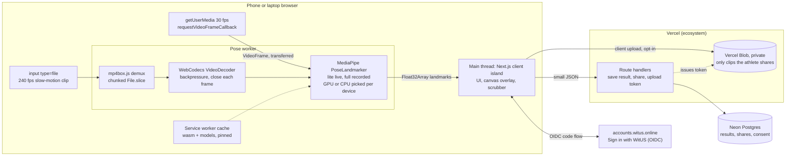

# Stack SWOT for the movement-assessment rebuild, with the emphasis on performance

**Written:** 2026-10-31 for Anthony McDonald (BAM) · **Status:** input to a decision BAM has not made yet · **Scope:** the portfolio rebuild decided in witus `plans/35` (BAM override, 2026-10-31): hurdle clearance from recorded side-on slow-motion video, the hurdle step screen, and movement assessments based on NASM's protocol (overhead squat, single-leg squat, push, pull), with live-camera and recorded-video modes, athletes and a coach, pose on the device, video on the device unless shared.

This file does not repeat the model-card limits, accuracy evidence or minors' rules. Those live in witus `plans/35-fit-t-cent-assessments-analysis.md` sections 0 and 9.

## 1. Recommendation

**Build it on the ecosystem stack (option A), but build the analysis pages as a client-only island that runs every pose call in a dedicated Web Worker, and run one phone spike before writing feature code.** Performance does not separate options A, B and C: all three run the same MediaPipe WebAssembly and WebGL code in the same browser engine, so inference and decoding cost the same. On this Mac the measured difference in shell JavaScript (Next.js 175 KB gzip against Vite 70 KB gzip) is about 1% of the 7.4 MB the analysis page must download anyway for the WebAssembly runtime and the lite model. What does separate them is ecosystem fit (Sign in with WitUS, Neon, shared rules, roadmap, CI), and A wins that outright. The one option that does change performance is native (D): it gets the original 240 fps file and the camera's high-frame-rate modes without the browser in the way. It also breaks the roadmap's owner decision that the app stays browser based, so it stays the fallback if the spike fails. The spike: on an iPhone in Safari, pick a 240 fps slow-motion clip, confirm the browser hands over all of its frames, then decode and pose the whole 5-second clip. If Safari transcodes the clip to a lower frame rate, the hurdle feature needs a workaround before anything else gets built.

## 2. Performance comparison

### 2.1 Measured on this Mac

**Label: this Mac, headless.** MacBook Pro 15-inch (2017), Intel Core i7-7820HQ (4 cores), Intel HD Graphics 630 through ANGLE Metal, 16 GB, macOS 13; Playwright's cached `chrome-headless-shell` 149.0.7827.55; `@mediapipe/tasks-vision` 1.2.0 with the float16 models; VIDEO running mode, one pose. "CPU" is MediaPipe's CPU delegate (XNNPACK on WebAssembly); "GPU" is its GPU delegate (WebGL2 on the real Intel GPU, not a software renderer). A laptop from 2017 is not a phone, so read these as relative costs, not phone numbers. The clips are synthetic: a 1920x1080, 240 fps, 5-second (1,200-frame) pan across MediaPipe's own test photo, encoded three ways (H.264 at 1.3 MB, H.264 at 64 Mbps / 42 MB, HEVC at 33 MB). The harness is in [`pose-bench/`](pose-bench/) and the raw results in [`pose-bench/results/`](pose-bench/results/).

| Test | Model | Delegate | Thread | Median ms per frame (p95) | 1,200 frames, total | Effective fps |
| --- | --- | --- | --- | --- | --- | --- |
| Decode only (WebCodecs `VideoDecoder`, mp4box.js demux) | none | hardware decode | main | 2.5 to 3.1 | 3.0 to 3.7 s | about 330 to 400 |
| Decode + pose | lite | CPU | main | 77.2 (93.0) | 95.7 s | 12.5 |
| Decode + pose, frame resized to 640x360 first | lite | CPU | main | 68.9 (90.4) | 88.4 s | 13.6 |
| Decode + pose | full | CPU | main | 109.8 (138.0) | 135.7 s | 8.8 |
| Decode + pose | lite | CPU | worker | 75.5 (89.5) | 93.2 s | 12.9 |
| Decode + pose | lite | GPU | main | 17.9 (22.9) | 23.2 s | 51.6 |
| Decode + pose, 64 Mbps H.264 | lite | GPU | main | 16.4 (19.4) | 21.4 s | 56.0 |
| Decode + pose, HEVC | lite | GPU | main | 16.1 (18.8) | 21.0 s | 57.1 |
| Decode + pose | full | GPU | main | 20.5 (24.0) | 26.1 s | 45.9 |
| Decode + pose | heavy | GPU | main | 33.4 (38.2) | 42.6 s | 28.1 |
| Decode + pose | lite | GPU | worker (OffscreenCanvas) | 16.7 (22.2) | 22.0 s | 54.6 |
| Decode + pose | full | GPU | worker (OffscreenCanvas) | 17.6 (23.0) | 23.3 s | 51.6 |

Per-frame latency on a 1920x1080 still passed as an `ImageBitmap` (50 frames after 10 warm-up frames): lite 97.1 / full 118.1 / heavy 395.3 ms on CPU, and 33.4 / 34.0 / 49.7 ms on GPU. Creating a landmarker took 0.45 to 0.85 s. The still-image GPU numbers are about twice the `VideoFrame` numbers above; I did not find out why (the `ImageBitmap` upload path is the likely suspect, unverified). Every frame in every run returned a pose.

What the numbers say:

1. **Pose estimation is the cost; decoding is not.** Hardware decoding of 1,200 frames of 1080p took about 3 s for H.264 and HEVC alike, and bitrate (1.3 MB against 42 MB) barely moved it. Pose took 7 to 30 times longer.
2. **The GPU delegate was 4 to 5 times faster than the CPU delegate here,** and full cost only about 12% more than lite on GPU. Heavy cost 83% more than lite. On phones the gap may differ: a MediaPipe maintainer confirms the web vision tasks run on WebGL, not WebGPU, and a developer reports that on several budget phones CPU beat WebGL (pgn-dev, 2025). The app should measure both on the first run and keep the faster one per device.
3. **A worker costs nothing.** The worker runs matched or beat the main thread, including GPU through OffscreenCanvas, and a worker keeps the page responsive while a clip is analyzed. Google's own guide says the detect calls "run synchronously and block the user interpose [sic] thread" and recommends workers (Google AI Edge, n.d.-b).
4. **Shrinking the frame before inference saved about 8% on CPU,** because the landmark model's input is 256x256 whatever you feed it (Google AI Edge, n.d.-a). Not worth an extra copy.
5. **No cross-origin isolation needed.** The `tasks-vision` 1.2.0 WebAssembly glue never touches `SharedArrayBuffer` (checked by grep), so MediaPipe runs single threaded and needs no COOP/COEP headers. Those headers matter only if you switch to a multi-threaded engine (section 4).

### 2.2 Download size of the analysis page

Measured from the npm package and the model files (gzip -9 and brotli default on this Mac):

| Asset | Raw | gzip | brotli |
| --- | --- | --- | --- |
| `vision_wasm_internal.wasm` (runtime) | 14.47 MB | 4.06 MB | 2.78 MB |
| `vision_bundle.mjs` (JS API) | 156 KB | 45 KB | 38 KB |
| `pose_landmarker_lite.task` | 5.78 MB | 4.96 MB | 4.59 MB |
| `pose_landmarker_full.task` | 9.40 MB | 8.36 MB | 7.83 MB |
| `pose_landmarker_heavy.task` | 30.66 MB | 28.54 MB | 26.98 MB |

First visit to an analysis page, compressed: **about 7.4 MB with lite, 10.7 MB with full, 15.3 MB with both, 29.8 MB with heavy.** At an assumed 10 Mbps phone connection (estimate) that is about 6, 9, 12 and 24 seconds; at 50 Mbps about 1.2, 1.7, 2.4 and 4.8 seconds. The models barely compress, so caching matters more than compression: serve them from the app's own origin with a pinned version and a long `Cache-Control`, and cache them in a service worker. Safari 17 and later let one origin use up to 60% of the disk for Cache API and service-worker storage, but can evict an origin the user has not interacted with "for some time" (WebKit, 2023), so the page must cope with a cold cache.

Shell JavaScript, measured by building a one-page client app with a button and a canvas: **Next.js 16.4.1 (App Router, Turbopack) ships 7 scripts, 570.5 KB raw, 174.9 KB gzip; Vite 6 with React 19 ships 1 script, 224.2 KB raw, 69.7 KB gzip.** The 105 KB difference is real but small next to the 7.4 MB analysis payload, and it applies only to the first visit.

### 2.3 Option-level comparison

| Factor | A. Next.js on Vercel (ecosystem) | B. Vite + Firebase | C. Vite SPA + thin API on Vercel | D. Native or cross-platform |
| --- | --- | --- | --- | --- |
| Pose inference per frame | Same engine as B and C; this Mac: lite GPU 17.9 ms, CPU 77.2 ms | Same | Same | Faster (estimate): native GPU and neural-engine paths. ML Kit's base model runs at about 30 to 45 fps on a Pixel 4 or iPhone X (Google, n.d.) |
| Decode of a 240 fps clip | WebCodecs, about 3 s per 1,200 frames here; Safari has full WebCodecs from 26.0, partial from 16.4 (Deveria, n.d.-b) | Same | Same | Native decoders; no browser limits |
| First-load shell JS (gzip) | 174.9 KB (measured, minimal page) | Under 70 KB for the app code plus the Firebase SDK (Firebase SDK size not measured) | 69.7 KB (measured) | App download from a store |
| Analysis payload, first visit | 7.4 MB lite, 10.7 MB full (measured) | Same | Same | Bundled in the app |
| Live camera frame rate | `getUserMedia`; iOS Safari reported limited to 60 fps for video frames and `requestVideoFrameCallback` (WebKit Bugzilla, 2024b; unverified for 2026) | Same | Same | Device formats up to 120 or 240 fps where the phone supports them (VisionCamera, n.d.) |
| Getting the original 240 fps file | `<input type=file>`; WebKit on iOS transcodes videos picked from the photo library to H.264 (WebKit, 2024). Whether 240 fps survives is **unverified** | Same | Same | Direct photo-library access (unverified per platform) |
| Uploading a 100+ MB clip | Vercel Blob client upload straight from the browser, multipart, files up to 5 TB; the 4.5 MB function body limit does not apply (Vercel, 2026a, 2026b, 2026c) | Firebase Storage uploads; needs the Blaze plan since 2026-02-03 (Firebase, n.d.-b) | Same as A | Any store; native background upload |
| Saving results (small JSON) | Route handler to Neon; under 4.5 MB | Firestore | Hono or route handler to Neon | Any API |
| Sign in with WitUS | Better Auth `genericOAuth`, same as vogoat and shop-witus | Firebase Auth OIDC needs Identity Platform; 50 OIDC users a month free (Firebase, n.d.-a) | Better Auth works, but the ecosystem's Next helpers need porting | Possible through an OIDC library; nothing in the ecosystem to reuse |
| CDN for the static shell | Vercel | Firebase Hosting | Vercel | App stores |

No source I found compares Core Web Vitals on Vercel and Firebase Hosting for a static shell. Both serve static files from a CDN; treat any difference as unmeasured.

## 3. SWOT per option

### A. Ecosystem stack: Next.js App Router on Vercel, MediaPipe Tasks in the browser, Better Auth with Sign in with WitUS, Neon, Vercel Blob or no video storage

**Strengths**
- Same stack as vogoat and shop-witus (Next 16.4.1, Better Auth `genericOAuth` with the `witus` provider, Neon with Drizzle, PostHog, Mailgun), so SSO, the shared rules, CI, the roadmap page and post-deploy automation apply without new work.
- Route handlers give the small API (save results, share, issue upload tokens) in the same project.
- Vercel Blob client uploads go browser to store, so a 300 MB clip never touches a function or its 4.5 MB body limit; private stores keep minors' clips behind auth (Vercel, 2026b, 2026d).
- `next/dynamic` with `ssr: false` keeps the analysis island out of server rendering and out of other routes' bundles (Next.js, 2026). Server rendering is still useful for the landing, about and method pages a portfolio piece needs.

**Weaknesses**
- 105 KB more gzip JavaScript than a Vite shell (measured), plus the Server Components model for an app whose core is a canvas.
- MediaPipe's WebAssembly and model files must be copied into `public/` and pinned by version, since Next's bundler should not process them.
- Vercel Blob's Hobby allowance is 1 GB of storage and 10 GB of transfer a month (Vercel, 2026c). At an estimated 40 MB per 5-second 240 fps clip (from the 480 MB per minute secondary figure in `plans/35`, unverified), about 25 stored clips fill it.
- Neon brings the preview-branch cleanup obligations in `docs/shared-rules.md` (workflow, project key, retention).

**Opportunities**
- A portfolio story that is both ecosystem-consistent and performance-literate: workers, WebCodecs, measured budgets.
- Results can flow to CentenarianOS as signed events (landmarks and scores, never video), as the roadmap backlog already says.
- An installable PWA with cached models is possible within Next.

**Threats**
- If a later engine needs threads (ONNX Runtime Web or TF.js WASM with threads), COOP/COEP isolation is required, and `require-corp` blocks cross-origin `no-cors` loads that lack a CORP header (MDN, n.d.). Safari does not support the `credentialless` relaxation for iframes (Deveria, n.d.-g). PostHog and any embeds would need same-origin proxying.
- Next.js major-version churn (the shared UI/UX/DX file already carries Next 15/16 rules).
- Private blobs over 100 MB are "not recommended" for delivery through functions unless traffic is low (Vercel, 2026d); a coach viewing clips needs presigned GET URLs or short clips.

### B. Keep Vite + Firebase: vanilla JS or a light framework, Firebase Hosting, Auth, Firestore, Storage

**Strengths**
- The overhead squat prototype exists and runs (README on `docs/real-readme`).
- The leanest client of the four, and Firebase Hosting is a static CDN.
- Firestore's realtime listeners suit "coach sees the athlete's result appear" with little code; Storage has resumable uploads.
- Firebase Auth's email and password tier is free up to 50,000 monthly users (Firebase, n.d.-a).

**Weaknesses**
- Not the ecosystem: Sign in with WitUS needs Identity Platform's OIDC provider, free for only 50 monthly users (Firebase, n.d.-a), and user IDs would not match the WitUS hub.
- Cloud Storage for Firebase requires the pay-as-you-go Blaze plan; "This requirement went into effect starting February 03, 2026" (Firebase, n.d.-b).
- Today's code loads the legacy `@mediapipe/pose` unpinned from jsDelivr, has no tests, and `npm audit` flags the `firebase` package's dependencies (README). The pose layer gets rewritten in every option, so "keep" saves less than it sounds.
- Security rules are a second policy language to test, alongside minors' data rules.

**Opportunities**
- Fastest path to a demo video if ecosystem fit did not matter.
- Firestore offline persistence for gym use without signal.

**Threats**
- Drift from every shared rule (Neon, SSO, roadmap registry, post-deploy automation) costs portfolio coherence, which is the point of a portfolio piece.
- Blaze billing with no spend cap by default (verify budget alerts before storing video).

### C. Vite SPA (React, Svelte or Solid) as a static client, plus a thin API (Hono or Next route handlers) on Vercel with Neon and Better Auth

**Strengths**
- The leanest client that still uses the ecosystem's data and auth choices; 69.7 KB gzip measured for React.
- Full control of headers, workers and asset handling, with no Server Components in the way.
- Inference and decoding perform exactly as in A.

**Weaknesses**
- No registered ecosystem repo uses Vite, Expo or React Native (checked `package.json` across `docs/ecosystem-repos.json`), so the SSO helpers (`auth.ts`, `silent-sso.ts`), CI templates and Next-specific rules need porting or rewriting.
- Two deployables (static client and API) or a custom Vercel setup; the landing and method pages need a prerender step for SEO.

**Opportunities**
- If the analysis engine later becomes a reusable package (for CentenarianOS or a coach tool), a framework-free core is easier to share. That is achievable inside A too.

**Threats**
- More glue code for one person to maintain, to save about 105 KB on first load.

### D. Native or cross-platform mobile (React Native with Expo or Flutter; on-device pose with ML Kit or native MediaPipe)

**Strengths**
- Camera formats up to the device's 120 or 240 fps can be selected directly (VisionCamera, n.d.), where web live capture is reportedly capped at 60 fps on iOS (WebKit Bugzilla, 2024b; unverified for 2026).
- Direct photo-library access sidesteps WebKit's video transcoding on file inputs (WebKit, 2024).
- Native GPU and neural-engine inference; ML Kit's base pose model runs at about 30 to 45 fps on 2019 phones (Google, n.d.). A third-party Flutter plugin claims about 12 ms on an iPhone 15 Pro (search snippet, unverified).
- Models ship in the app, so there is no per-visit download.

**Weaknesses**
- Store review, two platform builds, signing and release management for one developer.
- The roadmap records an owner decision that the app "stays browser based on phones and laptops."
- Nothing in the ecosystem to reuse; Sign in with WitUS needs a native OIDC flow.

**Opportunities**
- A small native "capture companion" that records at 240 fps and exports the original file is a possible fallback if the web cannot get the frames (section 6).

**Threats**
- Maintenance load and slower iteration; store policies for apps used by minors (not researched here).

## 4. Pose engines for the web

| Engine | Landmarks | Backends on the web | Runs in a Worker | Threads, COOP/COEP | Published speed | Notes |
| --- | --- | --- | --- | --- | --- | --- |
| **MediaPipe Tasks Vision `PoseLandmarker`** (lite, full, heavy) | 33, including heels and foot index, plus 3D world landmarks | CPU (XNNPACK on WebAssembly SIMD) or GPU (WebGL2); no WebGPU for vision tasks yet (pgn-dev, 2025) | Yes; GPU needs OffscreenCanvas (measured here; Safari has full OffscreenCanvas from 17.0, Deveria, n.d.-f) | Single threaded; no isolation needed (checked) | This Mac: section 2.1. Anecdote: a Pixel 10 Pro XL on Chrome 154 averaged 78.6 ms per frame for lite on CPU in a worker (BDubDesigns, 2026) | Detector plus tracker built in; the model card limits in `plans/35` apply |
| **TF.js MoveNet** (Lightning, Thunder) | 17 COCO keypoints; no heel or toe points | WebGL, WASM, WebGPU | Yes | WASM threads need isolation | iPhone 12, WebGL: 51 and 43 fps; Pixel 5: 34 and 12 fps (TensorFlow, 2022b) | Fast, but hurdle and step work needs foot points it does not have |
| **TF.js BlazePose** (TF.js runtime) | 33 | WebGL | Yes | No | iPhone 12, WebGL: 34 fps lite, 30 fps full; Pixel 5: 12, 11, 5 fps (TensorFlow, 2022a) | The same model family as MediaPipe; the benchmark tables date from 2022 |
| **ONNX Runtime Web** with RTMPose or YOLO-pose | 17 (COCO); other keypoint sets exist (unverified) | WASM or WebGPU; ORT's docs still list Safari WebGPU as Technology Preview only (ONNX Runtime, n.d.), while Safari 26 ships WebGPU on iOS (WebKit, 2025; Deveria, n.d.-a) | Yes | WASM threads need isolation | RTMPose-s: over 70 fps on a Snapdragon 865 natively; RTMPose-m: 75.8 AP on COCO (Jiang et al., 2023). No browser numbers found | Top-down: needs a separate person detector, so two models and your own tracking |
| **LiteRT.js** (Google, July 2026) | Runs `.tflite` models, not a pose pipeline | XNNPACK on WebAssembly; WebGPU; WebNN experimental | Not stated | Not stated | "Up to 3x" over other web runtimes, on an M4 MacBook Pro (Google for Developers, 2026) | Safari not mentioned. You would rebuild MediaPipe's detector and tracker yourself |

**Choice for this app: MediaPipe Tasks Vision `PoseLandmarker`,** lite for live mode and full for recorded clips, heavy as an opt-in "slow but best" pass. It is the only engine here with heel and foot-index landmarks out of the box, its runtime needs no cross-origin isolation, and it already runs in a worker with GPU. Revisit if MediaPipe ships WebGPU for vision tasks (issue still open, pgn-dev, 2025) or LiteRT.js gains a pose pipeline and Safari support.

## 5. Recommended architecture

### What runs where

- **Main thread:** UI only. React components, the canvas overlay, the scrubber, and the result screens. No pose calls and no decoding.
- **Pose worker** (one module worker, created with `new Worker(new URL('./pose.worker.ts', import.meta.url), { type: 'module' })`, which Next's bundler recognizes, Next.js, 2026): owns the `PoseLandmarker`, the delegate choice and, for recorded clips, the demuxer and `VideoDecoder`. Returns landmarks as transferable `Float32Array`s.
- **Live pipeline** (overhead squat, single-leg squat, push, pull, live hurdle step): `getUserMedia` at 30 fps target, then `requestVideoFrameCallback` on the main thread, then a `VideoFrame` transferred to the worker, then `detectForVideo` with the lite model, then landmarks back. Drop frames when the worker is busy (one frame in flight). `requestVideoFrameCallback` is best effort and capped at the display rate (Steiner, 2023), which is fine for live coaching cues.
- **Recorded pipeline** (track hurdle clearance, recorded versions of everything): `<input type=file accept="video/*">`, then read the container's frame rate and frame count first and warn if it is under 120 fps, then stream the file in chunks with `File.slice` into mp4box.js inside the worker (do not load a 300 MB clip into one `ArrayBuffer` on iOS), then `VideoDecoder` with backpressure (at most a few frames alive; close every frame at once), then `detectForVideo` with the full model and the media timestamps. The `<video>` element is for display only: it "does not guarantee frame-accurate seeking," and WebCodecs is the frame-accurate path (Steiner, 2023).
- **Two-pass analysis for long clips (estimate of savings):** pass 1 poses every 8th frame (30 fps equivalent, 150 poses for 5 s) to find the hurdle or step event from ankle and hip motion; pass 2 poses every frame in a window of about 1 second around it (about 240 poses). That is about 390 pose calls instead of 1,200. All frames are still decoded, which is cheap. On this Mac that is roughly 3 s of decoding plus 7 to 8 s of GPU pose, against 23 to 26 s for every frame.
- **Memory:** a 1080p decoded frame is about 3 MB (NV12, estimate). WebKit reports only about 300 MB reliably available to WebAssembly pages after reloads on iOS 17 (WebKit Bugzilla, 2024a; status in later iOS unverified). So: keep the decode queue short, never hold all frames, and store only landmarks plus a handful of downscaled key frames for the report.
- **Storage:** results (metrics, the landmarks for key frames, the coach's note) go as small JSON through a route handler to Neon. A full 1,200-frame landmark series is about 1.3 MB as `Float32Array` (33 landmarks, 4 values, image plus world coordinates; calculated), so it fits under 4.5 MB but belongs in Blob, compressed, if it is kept at all. **Video stays on the device by default.** Sharing a clip with a coach is an explicit per-clip action: a Vercel Blob client upload to a private store (multipart above 100 MB, as Vercel recommends), shown to the coach through a presigned GET URL or an auth-checked route, and deleted on a schedule. Minors' rules from `plans/35` section 5 apply before the first clip is stored.
- **Auth:** Better Auth with the `witus` `genericOAuth` provider, as in vogoat. No popups, so no COOP conflict; MediaPipe needs no isolation headers anyway.
- **Browser floor:** Safari 16.4 or later for WebAssembly SIMD (Deveria, n.d.-d) and the first WebCodecs `VideoDecoder`, with full WebCodecs from Safari 26 (Deveria, n.d.-b); `requestVideoFrameCallback` from Safari 15.4 (Deveria, n.d.-c); OffscreenCanvas in workers from Safari 17 (Deveria, n.d.-f). `SharedArrayBuffer` (Safari 15.2, only when cross-origin isolated; Deveria, n.d.-e) is not needed for this design. Older browsers get live mode only, with a plain message for recorded mode.
- **Offline:** a service worker precaches the shell, the pinned WebAssembly and the lite and full models after the first analysis, and queues result saves until the network returns.

## 6. Risks and the cheapest spike

| # | Risk | Likelihood | Impact | Evidence |
| --- | --- | --- | --- | --- |
| 1 | **iOS Safari does not hand the page the original 240 fps clip.** WebKit transcodes videos picked from the photo library through a file input to H.264 "due to known compatibility issues" (WebKit, 2024). If that transcode drops to 30 fps or bakes in the slow-motion ramp, hurdle analysis from the Photos library fails. | Unknown (unverified) | Fatal for recorded hurdle analysis on iPhone | WebKit commit; no test found of frame rate after transcode |
| 2 | Pose on a mid-range phone is too slow for whole clips | Medium | Long waits; mitigated by two-pass analysis | Pixel 10 Pro XL lite CPU 78.6 ms per frame (BDubDesigns, 2026), which means about 94 s for 1,200 frames on CPU; no iPhone Safari numbers found |
| 3 | iOS kills the tab while decoding a large clip | Medium | Crash mid-analysis | About 300 MB reliably available to WebAssembly pages after reloads (WebKit Bugzilla, 2024a) |
| 4 | Live camera capped at 60 fps or lower on iOS | High (reported) | Live mode limited to coaching cues; precise timing needs recorded clips | WebKit Bugzilla (2024b); unverified for 2026 |
| 5 | GPU delegate slower than CPU on some phones | Medium | Pick per device | pgn-dev (2025) |
| 6 | First visit downloads 7 to 11 MB before analysis | Certain | Slow first run on cellular | Measured (section 2.2) |

**Cheapest spike (half a day of code plus 30 minutes on BAM's iPhone):** make [`pose-bench/bench.html`](pose-bench/bench.html) self-contained (copy the `tasks-vision` and `mp4box` files and the two models into one static folder instead of reading `node_modules`), host it on any HTTPS URL (phones only allow camera and some media APIs on HTTPS), and open `bench.html?spike` in Safari on an iPhone (the model BAM's athletes would use, iPhone 12 or newer) and in Chrome on one mid-range Android phone. Record one 5-second 240 fps slow-motion clip and one 120 fps clip with the phone's Camera app. Pick each clip twice: once from **Photos** and once from **Files** (after "Save to Files"). The page prints the container's codec, frame count and frame rate, then decodes the clip and poses every frame with lite GPU, full GPU and lite CPU on the main thread, and full GPU in a worker.

Targets, written before the test runs:

| Check | Pass | Kill or redesign |
| --- | --- | --- |
| Frames delivered from Photos | At least 1,150 frames at 239 fps or more for the 240 fps clip | Under 120 fps: try Files; if Files also fails, recorded hurdle analysis needs a capture workaround (AirDrop to a laptop, or the native capture companion in option D) |
| Frames delivered from Files | Same | Same |
| Decode only, 1,200 frames | Under 10 s | Over 30 s |
| Decode + full model on GPU, 1,200 frames, worker | Under 60 s (stretch: 30 s) | Over 120 s, or two-pass analysis over 30 s |
| Stability | 3 runs in a row with no tab reload or crash | Any crash: shrink the decode queue, retest; a second crash moves recorded analysis to laptops only |

The harness loads the whole file into memory, so a crash on a 300 MB clip in this spike points at the harness first; production streams the file in chunks (section 5).

## 7. Unverified items

- Whether WebKit's H.264 transcode on file inputs keeps 240 fps, keeps every frame, or bakes in the slow-motion ramp; and whether picking from Files avoids it (risk 1).
- iPhone Safari pose speed for every model and delegate; no published 2026 benchmark found.
- iOS Safari live camera frame-rate cap in 2026 (reports are from 2024).
- The WebAssembly memory ceiling on current iOS (reports are from iOS 17).
- iPhone slow-motion file sizes (about 170 MB per minute at 120 fps and 480 MB per minute at 240 fps, secondary sources only, carried over from `plans/35`).
- That mp4box.js parses iPhone `.mov` files cleanly (QuickTime is close to, not identical to, MP4).
- Native speeds in option D beyond ML Kit's published base-model figures; the Flutter plugin figure is a search snippet.
- Firebase JavaScript SDK size (not measured).
- Any Core Web Vitals difference between Vercel and Firebase Hosting (no comparative source found).
- Why the GPU delegate was twice as slow on `ImageBitmap` stills as on `VideoFrame`s in this harness.

## References

BDubDesigns. (2026, October 8). *Pose Mode: On-device tracking benchmark, MediaPipe Lite vs MoveNet Lightning* (Issue No. 33) [GitHub issue]. GitHub. https://github.com/BDubDesigns/ToyStage/issues/33

Deveria, A. (n.d.-a). *WebGPU*. Can I use. Retrieved October 31, 2026, from https://caniuse.com/webgpu

Deveria, A. (n.d.-b). *WebCodecs API*. Can I use. Retrieved October 31, 2026, from https://caniuse.com/webcodecs

Deveria, A. (n.d.-c). *HTMLVideoElement API: requestVideoFrameCallback*. Can I use. Retrieved October 31, 2026, from https://caniuse.com/mdn-api_htmlvideoelement_requestvideoframecallback

Deveria, A. (n.d.-d). *WebAssembly SIMD*. Can I use. Retrieved October 31, 2026, from https://caniuse.com/wasm-simd

Deveria, A. (n.d.-e). *Shared Array Buffer*. Can I use. Retrieved October 31, 2026, from https://caniuse.com/sharedarraybuffer

Deveria, A. (n.d.-f). *OffscreenCanvas*. Can I use. Retrieved October 31, 2026, from https://caniuse.com/offscreencanvas

Deveria, A. (n.d.-g). *HTML element: iframe: credentialless*. Can I use. Retrieved October 31, 2026, from https://caniuse.com/mdn-html_elements_iframe_credentialless

Firebase. (n.d.-a). *Firebase pricing*. Google. Retrieved October 31, 2026, from https://firebase.google.com/pricing

Firebase. (n.d.-b). *FAQs about changes to Cloud Storage for Firebase pricing and default buckets*. Google. Retrieved October 31, 2026, from https://firebase.google.com/docs/storage/faqs-storage-changes-announced-sept-2024

Google. (n.d.). *Pose detection* (ML Kit). Google for Developers. Retrieved October 31, 2026, from https://developers.google.com/ml-kit/vision/pose-detection

Google AI Edge. (n.d.-a). *Pose landmark detection guide*. Google for Developers. Retrieved October 31, 2026, from https://developers.google.com/edge/mediapipe/solutions/vision/pose_landmarker

Google AI Edge. (n.d.-b). *Pose landmark detection guide for Web*. Google for Developers. Retrieved October 31, 2026, from https://developers.google.com/edge/mediapipe/solutions/vision/pose_landmarker/web_js

Google for Developers. (2026, July 9). *LiteRT.js, Google's high performance Web AI inference*. Google Developers Blog. https://developers.googleblog.com/en/litertjs-googles-high-performance-web-ai-inference/

Jiang, T., Lu, P., Zhang, L., Ma, N., Han, R., Lyu, C., Li, Y., & Chen, K. (2023). *RTMPose: Real-time multi-person pose estimation based on MMPose* (arXiv:2303.07399). arXiv. https://arxiv.org/abs/2303.07399

MDN. (n.d.). *Cross-Origin-Embedder-Policy (COEP) header*. Mozilla. Retrieved October 31, 2026, from https://developer.mozilla.org/en-US/docs/Web/HTTP/Reference/Headers/Cross-Origin-Embedder-Policy

Next.js. (2026, March 10). *How to lazy load Client Components and libraries*. Vercel. https://nextjs.org/docs/app/guides/lazy-loading

ONNX Runtime. (n.d.). *Using the WebGPU execution provider*. Microsoft. Retrieved October 31, 2026, from https://onnxruntime.ai/docs/tutorials/web/ep-webgpu.html

pgn-dev. (2025, January 15). *WebGPU support for Vision Tasks* (Issue No. 5826) [GitHub issue]. GitHub. https://github.com/google-ai-edge/mediapipe/issues/5826

Steiner, T. (2023, January 8). *Perform efficient per-video-frame operations on video with requestVideoFrameCallback()*. web.dev. https://web.dev/articles/requestvideoframecallback-rvfc

TensorFlow. (2022a). *BlazePose (MediaPipe runtime)* [README]. GitHub. https://github.com/tensorflow/tfjs-models/blob/master/pose-detection/src/blazepose_mediapipe/README.md

TensorFlow. (2022b). *MoveNet* [README]. GitHub. https://github.com/tensorflow/tfjs-models/blob/master/pose-detection/src/movenet/README.md

Vercel. (2026a). *Vercel Functions limits*. Retrieved October 31, 2026, from https://vercel.com/docs/functions/limitations

Vercel. (2026b). *Client uploads with Vercel Blob*. Retrieved October 31, 2026, from https://vercel.com/docs/vercel-blob/client-upload

Vercel. (2026c). *Vercel Blob pricing*. Retrieved October 31, 2026, from https://vercel.com/docs/vercel-blob/usage-and-pricing

Vercel. (2026d). *Private storage*. Retrieved October 31, 2026, from https://vercel.com/docs/vercel-blob/private-storage

VisionCamera. (n.d.). *Camera formats*. Margelo. Retrieved October 31, 2026, from https://visioncamera.margelo.com/docs/guides/formats

WebKit. (2023, August 10). *Updates to storage policy*. WebKit Blog. https://webkit.org/blog/14403/updates-to-storage-policy/

WebKit. (2024, March 12). *[iOS] Avoid transcoding images on file inputs unless the set of image types is explicitly restricted* (Bug 267277) [Source code commit]. GitHub. https://github.com/WebKit/WebKit/commit/02a5c284178e4c4c9184cf721954243d59678a03

WebKit. (2025, June 9). *News from WWDC25: Web technology coming this fall in Safari 26 beta*. WebKit Blog. https://webkit.org/blog/16993/news-from-wwdc25-web-technology-coming-this-fall-in-safari-26-beta/

WebKit Bugzilla. (2024a). *Only ~300 MB of RAM is reliably available to WebAssembly pages* (Bug 269777). https://bugs.webkit.org/show_bug.cgi?id=269777

WebKit Bugzilla. (2024b). *WebRTC doesn't support 120fps video stream decoding for iPadOS or iOS* (Bug 272393). https://bugs.webkit.org/show_bug.cgi?id=272393
