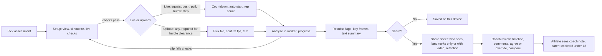

# UI, UX and DX research for the Fit T. Cent assessments rebuild

**Written:** 2026-10-31 · **For:** Anthony McDonald (BAM), before the build starts · **Researcher:** Claude (Opus 5.5)
**Scope:** the portfolio rebuild decided on 2026-10-31 (BAM override in WitUS plans/35): track hurdle clearance from recorded side-on slow-motion video, the hurdle step screen, and movement assessments based on NASM's protocol (overhead squat, single-leg squat, push, pull). Athletes or clients record; a coach or trainer reviews. Pose runs on the device, and video stays there unless the user chooses to share it.
**Not in scope:** choosing the framework or stack. A separate stack and performance SWOT does that. This file says what any stack must make possible and how to test it.

**What this builds on (not repeated here):** WitUS plans/35 (the vetting analysis) already covers the BlazePose model card limits (one person, about 4 m range, "entertainment" as the intended use), the sprint accuracy literature (about 4 to 11 degree errors), the minors, SafeSport, COPPA and FERPA findings with nine written mitigations, the positioning rules ("don't say AI coach, injury risk, accurate to X degrees"), and the competitor prices. Where a recommendation below depends on one of those, it points to plans/35 instead of re-citing it (Claude, 2026). The ecosystem UI, UX and DX standard applies in full (WitUS, n.d.).

Every source in the References list was fetched in this session (by Claude or by three research helpers it ran). Anything seen only in a search snippet, or not checked, is marked **UNVERIFIED**. Section 9 lists all of them.

---

## 1. Summary: recommendations

Read this page if you read nothing else. Each item names the source or finding behind it.

1. **Never brand it NASM or FMS, in the UI, the code, or the metadata.** NASM's terms bar use of its marks without written approval (National Academy of Sports Medicine [NASM], 2025), and Functional Movement Systems' terms say even certification does not license its marks (Functional Movement Systems, n.d.). Use plain names: "Overhead squat assessment (based on NASM's protocol)," "Hurdle step screen (published criteria)," plus a footer line: "Not affiliated with or endorsed by NASM or Functional Movement Systems."
2. **Show results as screening flags a coach confirms, not verdicts.** Trained raters agree only moderately on these screens: athletic trainers scoring knee cave on the overhead squat reached kappa .69 to .70 (Post et al., 2017), and two physiotherapists agreed with each other at kappa .61 while an app matched them at .55 to .63 (Biebl et al., 2021). Label every finding "Flagged" or "Clear," and give the coach a one-tap "Agree / Not this time" on each (Amershi et al., 2019, guideline 9, support efficient correction).
3. **Gate every angle on landmark visibility, and say "can't tell" instead of guessing.** MediaPipe returns a visibility likelihood for each landmark (Google, 2026b). When any of the three landmarks behind an angle is low, replace the number with a plain reason and a fix ("Your far knee is hidden. Film from the other side.") (Google PAIR, n.d.-b; Amershi et al., 2019, guideline 10).
4. **Show angles as estimates with a range, never as a bare number.** BlazePose's knee-valgus readings landed within about minus 9 to plus 7 degrees of manual 2D measurement (Janisch et al., 2026), and sprint angles are 4 to 11 degrees off (Claude, 2026). Write "about 92 degrees (plus or minus 7)" and round to whole degrees. Graphical uncertainty displays beat point values and text for decisions (Fernandes et al., 2018; Kay et al., 2016), so the detail view can show the per-rep spread as dots.
5. **Make setup the first-class screen, with live checks and concrete numbers.** Users "prefer to be guided really clearly" (Agile Kinetic, n.d.), and a body-shaped framing target helps people film themselves (Tesařová et al., 2023). Show a silhouette to step into, and check before recording: whole body in frame, one person, body fills about half the frame (OnForm's guidance; Onform, n.d.-a), phone level (Ochy added a level guide and a movement warning; Ochy, n.d.). Give numbers: hip height, 3 to 4 m away, square to the plane of motion (Kinovea, n.d.-d).
6. **Refuse to score a clip whose setup fails, and say why.** Silent failures are the most common complaint in this category (Ochy, n.d.; Trillo, n.d.; Kim, n.d.). A clip that fails the checks gets a reason and a "film again" path, not a confident wrong score (Google PAIR, n.d.-b).
7. **Hurdle clearance is upload-only, from the phone's own slow-motion camera, with the capture frame rate confirmed.** CoachNow recommends 120 fps for sprint mechanics and 240 fps for skeleton tracking (CoachNow Team, 2025). Kinovea stores capture fps separately from file fps so slow-motion timing stays right (Kinovea, n.d.-b). Ask "What frame rate did you film at?" when the file doesn't say, and block timing metrics until it's known.
8. **Calibrate distance from the hurdle itself.** Takeoff and landing distances need a pixel-to-meter scale. Let the user tap the hurdle's top bar and foot on one frame and pick the height from the World Athletics table (for example 1.067 m, 0.991 m, 0.914 m, 0.838 m, 0.762 m; World Athletics, 2026). Pose doesn't see the hurdle.
9. **Auto-detect key events, then let the user nudge each one a frame at a time.** Takeoff, lead-knee peak, crossing, and touchdown are found from ankle and knee motion, shown as markers on the timeline, and editable with arrow keys or step buttons (Amershi et al., 2019, guideline 9; Kinovea's key-image markers, Kinovea, n.d.-a).
10. **Build the scrubber as an accessible slider with frame steps, tap-to-seek, and a filmstrip.** ARIA's slider pattern gives arrows one step, Page Up and Down a bigger jump, Home and End the ends, and `aria-valuetext` like "1.42 seconds, frame 85 of 240" (W3C WAI, n.d.-j). WCAG 2.2's dragging rule means dragging can't be the only way (W3C WAI, n.d.-g). OnForm users called its flywheel scrubber a "major downgrade" (Onform Inc., n.d.), and OnForm added a filmstrip.
11. **Draw overlays that stay readable on any video frame, and don't hide the athlete.** Graphics needed to understand content need 3:1 contrast against adjacent colors (W3C WAI, n.d.-b). On video that means a light stroke with a dark halo. Thick skeletons hid users' own bodies in earlier studies (Adolf et al., 2024), so draw thin lines and highlight only the joints being judged, with the full skeleton one tap away.
12. **Never use color alone.** Pair every color with an icon and a word: check and "Clear," triangle and "Flagged," dashed outline and "Can't tell" (World Wide Web Consortium [W3C], 2024, SC 1.4.1; Neusesser & Sunwall, 2023). Name the body part ("left knee"), never "the red joint" (W3C, 2024, SC 1.3.3).
13. **Give every result a text version.** A recorded clip is prerecorded video-only content, so it needs a text alternative (W3C WAI, n.d.-a). The pose output is that alternative: a per-rep summary and a timestamped list of events ("0.84 s: touchdown, lead knee about 160 degrees"). Announce new results politely through a status region (W3C WAI, n.d.-i).
14. **One live cue at a time, throttled, by priority, with a mute.** Frequent spoken corrections felt "stressful" (Adolf et al., 2024). Physitrack plays one prompt at a time with a cooldown (Physitrack, n.d.), and Eyes-Free Yoga ordered corrections core first, then head, then limbs (Ma, 2013). Speech carries eyes-free guidance, because iOS Safari doesn't support the Vibration API at all (Can I use, n.d.).
15. **Process frames in a worker, and show real progress.** `detect()` and `detectForVideo()` are synchronous and block the main thread (Google, 2026b). Progress bars make people wait about three times longer (Sherwin, 2014); use percent-done with frames counted for anything over 10 seconds (Tankala, 2023; Nielsen, 1993).
16. **Self-host and pin the model and runtime, cache them for offline, and ask for persistent storage at the right moment.** The `.task` files are 5.8 MB (lite), 9.4 MB (full) and 30.7 MB (heavy), and the WebAssembly runtime is about 14.5 MB (measured this session; Google, n.d.-c; jsDelivr, n.d.). `@mediapipe/tasks-vision` shipped six stable releases between April and October 2026 (npm, n.d.), so pin an exact version. The Cache API ignores HTTP caching headers (MDN contributors, n.d.-b), Safari can wipe script storage after seven days without interaction (MDN contributors, n.d.-a), and `navigator.storage.persist()` should be called after a meaningful action, never on load (LePage, 2020).
17. **Make the coach view a timeline with pinned comments, linked side-by-side compare, and short voice notes.** OnForm and CoachNow both sync two clips for scrubbing, Kinovea syncs on a shared event, and OnForm advises "Thirty seconds on one key point" (Onform, n.d.-b; CoachNow, n.d.; Kinovea, n.d.-c). Sync compare on a named event (touchdown, bottom of the squat).
18. **Private by default, landmarks before video, export from day one.** StartIQ and Physitrack keep frames on the device and send only numbers (Kim, n.d.; Physitrack, n.d.). Hudl Technique's 2021 shutdown forced users to migrate or lose their history (Paulley, 2021). Share key frames and landmark data by default, video only on an explicit choice with the retention window shown (plans/35, G4 mitigations 1 and 3 to 7).
19. **Keep the core testable without a camera or a GPU.** Put angle math, smoothing, event detection, and the rules in a pure module tested against golden landmark JSON. Run the real model only in a separate regression job on the CPU delegate (`delegate: "CPU"` is a supported option; Google, 2026c), with pinned fixtures. Section 7 has the plan.
20. **Treat frame-accurate processing of recorded video as a spike before committing.** `requestVideoFrameCallback` fires at most at the display refresh rate, so a 120 fps clip played on a 60 Hz screen skips frames, and the video element does not promise frame-accurate seeking (Steiner, 2023; MDN contributors, n.d.-e). WebCodecs gives exact frames but needs a demuxer (MDN contributors, n.d.-f). Test both on iPhone and Android files first.

---

## 2. The assessments: protocol, camera, and what 2D pose can measure

This section is the source of truth for the checkpoint lists the UI shows. "Measurable" means from MediaPipe's 33 2D landmarks (shoulders, elbows, wrists, hips, knees, ankles, heels, foot index points, ear and nose). The measurability column is Claude's inference from the landmark set and the cited accuracy studies, not a validated claim.

### 2.1 Overhead squat assessment (based on NASM's protocol)

**Protocol.** Barefoot or flat shoes, feet shoulder-width and pointed straight ahead, arms overhead with elbows straight so the upper arms frame the ears, about five controlled reps to roughly chair height, viewed from the front and the side (Cherry, 2026a). NASM's current page lists front and side only. A posterior view, asymmetric weight shift, and heel rise appear in older material that now redirects: **UNVERIFIED** as current NASM protocol.

| View | Checkpoint (NASM's name) | From 2D pose? | How the app estimates it |
|---|---|---|---|
| Front | Feet turn out | Partly | Heel to foot-index line angle against straight ahead; foot points are noisy, so use the median across reps |
| Front | Feet flatten | **No** | Pronation isn't visible in 33 landmarks. Show as "coach checks by eye" |
| Front | Knees move inward (valgus) | **Yes** | Frontal plane projection angle (hip, knee, ankle). The best-supported 2D measure: r = 0.78 against 3D (Gwynne & Curran, 2014) |
| Front | Knees move outward | Yes | Same angle, other direction |
| Front | Asymmetric weight shift | Yes (if kept) | Hip midpoint offset from ankle midpoint |
| Side | Excessive forward lean | Yes | Trunk (shoulder to hip) angle compared with the shin angle |
| Side | Low back arches | Proxy only | Change in the shoulder, hip, knee angle. No lumbar landmark exists |
| Side | Posterior pelvic tuck ("butt wink") | **No, not reliably** | Same proxy; too subtle for 2D landmarks. "Coach checks by eye" |
| Side | Arms fall forward | Yes | Shoulder to wrist line against the trunk line (the current repo measures elbow bend instead, which is a different thing) |
| Side | Forward head | Rough proxy | Ear relative to shoulder |
| Side | Heel rise | Weak | Heel vs foot-index height gap; lost in jitter at normal frame rates |

**Live or recorded:** both work. Five slow reps fit a live session; recording keeps a reviewable clip.

### 2.2 Single-leg squat (based on NASM's protocol)

**Protocol.** Hands on hips, lift one foot with the knee slightly bent, squat toward a depth where the thigh is about parallel, front view (Read, n.d.-c, a secondary study guide citing NASM's textbook). The only compensation that guide lists is the knee moving inward. Hip hike or drop, trunk rotation, and a count of five reps per side appear only in flashcards and third-party checklists: **UNVERIFIED** against NASM.

| Checkpoint | From 2D pose? | Evidence |
|---|---|---|
| Knee moves inward | **Yes** | FPPA with cameras about 3 m away at knee height: r = 0.78 against 3D, between-session ICC 0.74, error 2 to 4 degrees (Gwynne & Curran, 2014). Validity varies with depth, stance leg, and valgus group (Jamaludin et al., 2022). BlazePose vs manual 2D: bias minus 0.67 degrees, limits of agreement minus 8.76 to 7.42 (Janisch et al., 2026) |
| Hip hike or drop | Yes | Tilt of the hip line |
| Trunk rotation | Hard | Partial proxy: shoulder width shrinking relative to hip width |

### 2.3 Pushing and pulling assessments (based on NASM's protocol)

**Protocol (secondary sources).** Push: standing cable chest press in a split stance, a load the client can move for about 20 reps, side view; a push-up is the fallback. Pull: standing cable row (Read, n.d.-a, n.d.-b). NASM's own blog confirms the watch-points "shoulder elevation" and "head jutting forward" during rows and presses (Cherry, 2026b). NASM's own protocol page for either test: **UNVERIFIED**. The rep count for pulling: **UNVERIFIED**.

| Checkpoint | From 2D pose? | Note |
|---|---|---|
| Low back arches | Proxy | Shoulder, hip, knee angle change |
| Shoulders elevate | Partial | Ear-to-shoulder vertical distance shrinking; scapular elevation itself isn't visible |
| Head juts forward | Proxy | Ear forward of shoulder |

**Camera note (inference):** film from the side away from the cable machine, so the stack and cable don't cross the body.

### 2.4 Hurdle step screen (published criteria; not an FMS score)

**Protocol.** Feet together, toes touching the base of a hurdle set to the height of the tibial tuberosity, dowel across the shoulders behind the neck, step over, touch the heel to the floor without taking weight, return; slowly, up to three times each side. Score 3 (hips, knees and ankles stay aligned in the sagittal plane, minimal lumbar movement, dowel stays parallel to the hurdle), 2 (any of those lost), 1 (contact with the hurdle, or loss of balance), 0 (pain). Score the stepping leg; record the lower side; "when in doubt score low" (Cook et al., 2014a). The screen is "directional," not diagnostic (Cook et al., 2014b).

| Criterion | From 2D pose? | How |
|---|---|---|
| Hip, knee, ankle alignment | Yes, front view | Stepping-leg drift out of line |
| Minimal lumbar movement | Proxy | Trunk angle change |
| Dowel parallel to hurdle | Proxy | Shoulder line or wrist line tilt (the dowel itself isn't tracked) |
| Contact with the hurdle | **No** | User or coach reports it |
| Loss of balance | Partly | Large hip sway, a second foot touchdown; coach confirms |
| Pain | **No** | Ask the user every time, and score 0 if yes |

**Automation evidence:** a depth-camera system agreed with one experienced rater on 84.6% of hurdle steps (Blast Injury Research Coordinating Office, 2019). No 2D phone-video validation was found. So the app proposes a score and the coach sets it.

**Branding:** Cook et al. (2014a) note the screen "can be performed without the use of any trademarked equipment," but the name is a registered mark. Call it "Hurdle step screen," cite the paper on an info sheet, and never show "FMS score" or a 21-point total.

### 2.5 Track hurdle clearance (side-on, recorded slow motion)

**Rules and reference values.** World Athletics heights: 1.067 m (men's 110 m), 0.991 m (U20 men), 0.914 m (U18 men and 400 m men), 0.838 m (women's 100 m and U18 men 400 m), 0.762 m (U18 women and women's 400 m); spacing 9.14 m (110 m) and 8.50 m (100 m) (World Athletics, 2026). National youth heights differ (Athletics Ireland, 2020), so the height picker needs a custom value.

**Technique checkpoints (coaching sources).** Lead leg: a knee drive until the knee just clears the hurdle height, then the lower leg extends, a "stepping over" action rather than a kick, landing in line. Trail leg: compact, heel near the buttock, foot dorsiflexed, knee always higher than the foot. Arms: the arm opposite the lead leg leads; crossing the midline induces rotation. Faults: jumping the hurdle, leading with the foot, trail leg swinging out to the side (Athletics Ireland, 2020).

**Biomechanics reference (elite only).** Colin Jackson: takeoff 2.09 m and landing 1.58 m of a 3.67 m hurdle stride (about 57:43; the cited optimum is 60:40), trunk about 37 degrees from vertical, flight 0.36 s (Coh et al., 2004). World Championship finalists: hurdle step 3.80 m (men) and 3.16 m (women), clearance time 0.33 s and 0.28 s (Hanley et al., 2021); lead knee at touchdown before the hurdle 166 degrees (men) and 156 degrees (women), measured on sagittal-plane projections (Bissas et al., 2022). These are world-class adults and must be labeled that way, never shown as a target for a 15-year-old.

| Metric | From side-on 2D? | Note |
|---|---|---|
| Takeoff distance, landing distance, ratio | Yes, with calibration | Needs the hurdle tapped and its height set (recommendation 8) |
| Lead knee angle at takeoff and touchdown | Yes, near side | Far-side leg is occluded half the time |
| Trunk lean at takeoff, over the hurdle, at touchdown | Yes | Shoulder to hip line against vertical |
| Hip rise over the hurdle (center-of-mass proxy) | Yes | Hip midpoint height relative to takeoff |
| Flight time, contact times | Yes, if capture fps is known | Needs 120 fps or more |
| Trail leg out to the side (abduction) | **No** | Frontal-plane motion; a front or rear camera is needed |
| Arm crossing the midline | **No** from the side | Same reason |
| Hurdle contact, knocked hurdle | **No** | User reports it |

Camera distance, the 4 m model limit, and one-athlete framing are in plans/35 section 9 and are not repeated here.

---

## 3. Pose feedback rules (apply to every screen)

1. **Three confidence states, one vocabulary.** Every angle, checkpoint, and event has a state: **Clear** (all contributing landmarks above the visibility threshold for most of the window), **Estimate** (some frames below threshold; value shown with a wider range), **Can't tell** (too few good frames; no value). Raw probabilities are never shown, because "numeric confidence indicators are risky" (Google PAIR, n.d.-a). The threshold starts at MediaPipe's default 0.5 for detection, presence, and tracking (Google, 2026a) and is tuned on fixtures.
2. **No false precision.** Whole degrees only; a plus-or-minus range taken from the measurement spread for that rep and widened by a fixed floor for the known model error (start at 5 degrees; inference from Janisch et al., 2026); the word "about" in sentences; "estimated" on every chart axis. Distances to the nearest 5 cm.
3. **Say what, why, and what to do next.** "Knees moved inward on 3 of 5 reps" (what), "seen from the front, your knees tracked inside your ankles" (why), "Coach will review" or "Film the side view next" (next). PAIR: "Don't say what without saying why in a high stakes scenario" (Google PAIR, n.d.-a).
4. **Error states have a reason and a path.** Each maps to a detectable condition:

   | Condition | Detection (inference) | Message | Action |
   |---|---|---|---|
   | No person | No pose returned for 1 s | "We can't see anyone yet." | Show silhouette |
   | Part of the body out of frame | Ankles or wrists missing or low visibility while hips are clear | "Your feet are out of the picture. Step back or tilt the phone down." | Live check chip turns to "Fix" |
   | Too far | Body height under about 40% of frame height | "Move the phone closer. You should fill about half the screen." | Distance chip |
   | Too close | Body height over about 90% of frame | "Step back a little." | Distance chip |
   | Two people | Run with `numPoses: 2` during setup only and warn if a second pose appears | "Someone else is in the picture. Only one person at a time." | Block recording |
   | Wrong view | Shoulder width vs hip width ratio says front when side was asked | "Turn side-on to the camera." | View chip |
   | Phone moving | Device orientation change, or the background shifting | "Hold the phone still or prop it up." | Level chip |
   | Low frame rate (hurdles) | Capture fps under 120 | "This clip is too slow to time ground contacts. Angles only." | Disable timing metrics |
   | Model failed to load | Fetch or init error | "The movement model didn't load. Check your connection and try again." | Retry button |

   The "too far" and "too close" thresholds are starting guesses to tune; ML Kit asks for the subject to be at least 256 by 256 pixels and to fill as much of the frame as possible (Google, n.d.-b).
5. **Progressive disclosure, two levels.** Level 1 for athletes and novices: the checkpoint list, a key frame for each flag, and the coach's note. Level 2 ("Details") for coaches: angles with ranges, per-rep table, landmark confidence timeline, full skeleton, event marker editing. NN/g warns that more than two levels usually fails (Nielsen, 2006).
6. **One-handed at a track, propped at home.** About half of observed touch use is one-handed, and grips change every few seconds (Hoober, 2013). Accuracy falls from 7 mm at screen center to 12 mm at the corners (Hoober, 2017). Put Record, Stop, and frame step in the bottom center; keep Delete away from them, with undo; make bottom-row targets 48 px or more. For self-filming, start recording hands-free: a countdown after the person settles into the silhouette (Agile Kinetic's automatic trigger tested best; Agile Kinetic, n.d.).
7. **Offline at a field.** Once the model is cached, setup, recording, analysis, and viewing results work with no network. Sharing and coach sync queue until the connection returns; the ecosystem standard keeps auth and admin network-only (WitUS, n.d.). Show a small "Offline: results saved on this phone" note, not an error.
8. **Perceived performance.** First visit: a percent-done bar with megabytes for the model download, announced through a status region. Warm-up: run one inference on a blank frame while the user reads the setup screen, so the first real frame doesn't stall (inference). Analysis of a clip: percent-done with "Frame 312 of 960" and a Cancel button. Under 1 s: show nothing extra (Tankala, 2023).

---

## 4. Screen flows

### 4.1 The shared flow

Every assessment uses the same five steps. Only setup and results change by assessment.



**First run only:** before the first setup, one screen says what the app sees and doesn't. "This app looks at your body's outline in 2D from one camera. It can see joint angles from the front or side. It can't see depth, muscles, or pain, and it isn't a medical test. Your video stays on this phone unless you share it." (Google PAIR, n.d.-c; Amershi et al., 2019, guidelines 1 and 2.)

### 4.2 Overhead squat (two views)

1. **Setup (front).** Silhouette in a squat-ready pose with arms overhead. Chips: Whole body, One person, Distance, Level, Facing camera. Instructions as text and optional speech: "Feet shoulder-width, toes forward, arms straight overhead, shoes off or flat shoes" (Cherry, 2026a).
2. **Record.** Countdown 3, 2, 1 when the person holds still in the silhouette for one second. Rep counter counts five. Live cue limited to one, e.g. "Arms up by your ears," at most every 4 seconds (inference; Adolf et al., 2024).
3. **Prompt for the side view.** "Now turn so your right side faces the phone." Same checks with the side silhouette. Five more reps.
4. **Analyze.** Both captures, per rep.
5. **Results.** Checkpoint list grouped by view. Each row: icon, name, state, count ("Knees moved inward: 3 of 5 reps, Flagged"), key frame thumbnail at the worst rep. Checkpoints the app can't measure (feet flatten, butt wink) are listed under "Your coach checks these by eye," so the athlete sees the protocol is complete.
6. **Coach review.** Agree or override per flag, a note, optional voice note.

### 4.3 Single-leg squat

Front view, one leg then the other. The setup asks "Which leg are you standing on?" with a picture, then verifies it from the lifted ankle. Results compare left and right side by side as a two-column table plus a mirrored key frame pair, since symmetry is the question a trainer asks (Exer compares involved and uninvolved sides; Exer Labs, n.d.).

### 4.4 Push and pull

Side view. Setup asks which equipment (cable machine, bands, push-up fallback) and shows the matching silhouette. For the push-up fallback the phone goes at floor level. Rep counter targets about 20 (secondary source; see 2.3). Results: three checkpoints, each with the "proxy" caveat in the Details level ("Estimated from your ear and shoulder positions").

### 4.5 Hurdle step screen

1. **Setup.** Equipment checklist: a hurdle or a band at shin-bone bump height, a dowel or broomstick. Front view first, side view optional. Silhouette with the dowel across the shoulders.
2. **Record.** Up to three slow reps per side, guided ("Step over with your right leg, touch your heel, come back").
3. **Ask.** After each side: "Did you touch the hurdle?" and "Did you feel pain?" Yes to pain sets the score to 0 and shows "Stop and talk to your coach or a clinician" (Cook et al., 2014a). The app never interprets pain.
4. **Results.** "Suggested score: 2 (right), 3 (left). Recorded: 2." Each criterion with its state. The coach sets the final score.
5. **Info sheet.** The criteria with the citation, and the not-affiliated line.

### 4.6 Track hurdle clearance

1. **Before filming (a printable guide).** Side-on, perpendicular to the lane at the hurdle, hip height, 3 to 4 m from the lane, landscape, one athlete in frame, phone slow motion at 120 or 240 fps, send the original file (not through a chat app) (plans/35 section 11; CoachNow Team, 2025; Kinovea, n.d.-d). A diagram, not just text.
2. **Upload.** File picker for video. Read duration and frame count; if the capture rate can't be read, ask with presets (30, 60, 120, 240) and an explanation (Kinovea, n.d.-b). Trim to the clearance with a working-zone handle pair (Kinovea's working zone; Kinovea, n.d.-a).
3. **Calibrate.** On a paused frame: "Tap the top of the hurdle bar," then "Tap where the hurdle meets the ground." Pick the height from the World Athletics list or enter it. Show the scale ("1 m is about 212 pixels here") so a bad tap is visible.
4. **Analyze.** Worker runs pose on every frame (or every frame the chosen decode path gives; section 7.3). Key events detected: takeoff (last contact before the hurdle), lead-knee peak, over the hurdle, touchdown.
5. **Review events.** A timeline with four markers. Each marker can be moved by frame. Metrics recompute on change.
6. **Results.** Level 1: four key frames in a row with a plain line under each ("Takeoff: about 2.0 m before the hurdle"), then up to three coaching notes in priority order. Level 2: all metrics with ranges, the takeoff-to-landing ratio against the 60:40 reference (Coh et al., 2004), the elite reference table labeled "world-class adults," and what wasn't measured ("Trail leg sideways swing needs a front camera").
7. **Coach review.** Comments pinned to frames, compare with an earlier clip synced on touchdown.

### 4.7 Wireframes (rough)

**Setup screen (portrait, phone propped):**

```
+--------------------------------+
| <  Overhead squat   Front view |
|                                |
|   .------------------------.   |
|   |          ( )           |   |
|   |        \  |  /         |   |
|   |          /|\           |   |   silhouette outline, dashed
|   |          / \           |   |   live skeleton drawn inside
|   |         /   \          |   |
|   '------------------------'   |
|                                |
| [ok] Whole body  [ok] 1 person |
| [!] Step back    [ok] Level    |   chips: icon + word, never color only
|                                |
| "Step back about one big step" |   status text, also spoken if on
|                                |
|      [  Start when ready  ]    |   bottom center, 48 px tall
|  Voice cues: On      Upload    |
+--------------------------------+
```

**Results, level 1:**

```
+--------------------------------+
| Overhead squat     Oct 31      |
| 2 flagged, 3 clear, 2 by eye   |
|--------------------------------|
| /!\ Knees moved inward         |
|     3 of 5 reps . Front  [img] |
| /!\ Arms fell forward          |
|     4 of 5 reps . Side   [img] |
| (v) Feet stayed forward        |
| (v) Torso angle about even     |
|     with shins                 |
| (?) Low back: can't tell       |
|     Side view was too dark     |
|--------------------------------|
| Coach checks by eye:           |
|  Feet flattening, pelvic tuck  |
|--------------------------------|
| [ Details ]   [ Share with     |
|                 coach ]        |
+--------------------------------+
```

**Scrubber and event markers (landscape, hurdle clearance):**

```
+--------------------------------------------------------------+
|                      video + overlay                          |
|                                                              |
|  [< frame] [ play ] [frame >]   Speed: 10% of real speed  [v] |
|  |----T--------K------O-----D----------------------------|   |
|       ^takeoff ^knee  ^over ^touchdown     0.84 s . fr 202  |
|  [thumb][thumb][thumb][thumb][thumb][thumb][thumb]  filmstrip |
+--------------------------------------------------------------+
```

Speed is shown as a share of real-world speed, as Kinovea does, so "10%" on a 240 fps clip means real time divided by ten (Kinovea, n.d.-a).

---

## 5. Component inventory

Framework-neutral names. File and naming conventions follow the ecosystem standard once the stack is picked (WitUS, n.d.).

| Component | Purpose | States | Accessibility notes |
|---|---|---|---|
| App header | Brand, nav, **Sign in** link (exact name) when signed out, Sign out when signed in | loading, signed out, signed in | Required by the standard, with a `@smoke` test (WitUS, n.d.) |
| Assessment picker | Cards: name, view(s), equipment, time, live or upload | default, last used | Cards are links or buttons, not clickable divs |
| First-run explainer | What it sees and doesn't, privacy line | shown once, reopenable from Help | Heading focused on open |
| Camera permission gate | Explains why before the browser prompt; recovery steps if denied | prompt, denied, unavailable, granted | Denied state gives text steps per browser |
| Setup coach | Silhouette, live skeleton, check chips, spoken prompt | checking, fix needed, ready | Chips use icon plus word; prompt text in a polite status region |
| Level and steadiness indicator | Phone tilt and movement | level, tilted, moving | Text value, not just a bubble graphic |
| Recorder | Countdown, auto-start, rep counter, stop | idle, counting down, recording, paused | Countdown spoken and shown; reduced motion swaps the animated ring for numbers |
| Clip importer | File input for video, trim handles | empty, reading, ready, unsupported file | Native file input with a visible label; trim handles also take typed times |
| Frame-rate dialog | Confirm capture fps | detected, ask, set | Radio group with explanations |
| Hurdle calibrator | Tap hurdle top and base, pick height | step 1, step 2, done, implausible | Each tap also adjustable with arrow keys; a text readout of the scale |
| Model loader | Download and warm-up | cached, downloading percent, warming, failed | `role="status"` with percent; Retry on fail |
| Analysis progress | Per-frame processing | running percent, cancelled, done, failed | Status region announces at 25% steps, not every frame (W3C WAI, n.d.-i) |
| Video stage | Video plus overlay canvas | playing, paused, frame step | Video has a text alternative (Text summary below) |
| Pose overlay | Skeleton, angle arcs, judged joints | minimal (judged joints only), full, off | Light stroke with dark halo for 3:1 on any frame; no color-only meaning |
| Frame scrubber | Slider, step buttons, filmstrip, speed | at frame N, playing | ARIA slider: arrows one frame, Page keys one second, Home and End; `aria-valuetext`; tap-to-seek; 24 px minimum targets, 48 px preferred |
| Event marker editor | Takeoff, knee peak, over, touchdown; squat bottom | auto, user-moved | Each marker focusable, moved with arrows, announced by name and time |
| Checkpoint list | Results rows | Clear, Flagged, Can't tell, Coach checks by eye | Icon plus word plus count; a list element with real text |
| Angle readout | "about 92 degrees (plus or minus 7)" | clear, estimate, can't tell | Spoken form avoids symbols ("plus or minus") |
| Confidence timeline (Details) | Per-landmark visibility over time | n/a | Table alternative |
| Rep table (Details) | Per-rep values | n/a | Real `<table>` with headers |
| Compare view | Two clips, linked scrub, sync on event, overlay opacity | side by side, stacked, overlay | Linked toggle is a labeled switch; works stacked in portrait |
| Coach comment timeline | Comments pinned to frames, voice notes | none, unread, read | Each comment lists its timestamp as text; voice notes get a transcript or a text summary from the coach |
| Flag override | Agree or Not this time per flag | unset, agreed, overridden | Two real buttons, not a swipe |
| Share sheet | Who sees it, landmarks only or with video, retention, parent copy for minors | draft, sent | Plain-language summary before Send |
| Text summary | Screen-reader and printable result | n/a | The text alternative for each clip (W3C WAI, n.d.-a) |
| Toast and status region | Non-blocking messages | info, success, error | Never `alert()` (WitUS, n.d.); errors use `role="alert"` only when urgent |
| Settings | Voice cues, earcon mode, overlay detail, units, language | n/a | Respects `prefers-reduced-motion` without a setting |
| Storage and offline panel | Model cached, space used, clips on device, delete all | ok, low space, evicted | Delete all needs a confirm modal with undo window |
| Export | JSON and CSV of landmarks and results, PDF report | n/a | Export from day one (Paulley, 2021) |

---

## 6. Accessibility checklist

Target WCAG 2.2 AA, plus the ecosystem rules (44 px targets, slate neutrals, both themes contrast-checked; WitUS, n.d.). Success criteria from W3C (2024) unless noted.

| # | Requirement | WCAG 2.2 | How this app meets it |
|---|---|---|---|
| 1 | Every visual result has a text equivalent | 1.1.1 Non-text Content (A) | Checkpoint list is text; key frames have alt text naming the event and value |
| 2 | Recorded clips have a text alternative | 1.2.1 Audio-only and Video-only, Prerecorded (A) | Generated per-rep summary and timestamped event list. The live preview counts as live, so 1.2.1 doesn't apply to it (W3C WAI, n.d.-a) |
| 3 | Demo and help videos with sound have captions and, if movement is shown only visually, audio description | 1.2.2 (A), 1.2.5 (AA) | Only for videos the app ships, not users' own clips |
| 4 | Instructions don't depend on color, shape, or position alone | 1.3.3 Sensory Characteristics (A) | "Left knee," never "the red dot" |
| 5 | Color is never the only signal | 1.4.1 Use of Color (A) | Icon plus word on every state (W3C WAI, n.d.-c) |
| 6 | Text on video meets 4.5:1 | 1.4.3 Contrast Minimum (AA) | Labels over video sit on a solid or scrim background |
| 7 | Overlay lines and arcs meet 3:1 against adjacent colors | 1.4.11 Non-text Contrast (AA) | Light core stroke with a dark halo; test the color pair, since axe can't measure canvas pixels (inference) (W3C WAI, n.d.-b) |
| 8 | Tooltips on angles are dismissible, hoverable, persistent | 1.4.13 (AA) | Or avoid hover-only content entirely |
| 9 | Everything works by keyboard | 2.1.1 Keyboard (A) | Scrubber, markers, calibrator taps, compare, comments |
| 10 | Moving or auto-updating content can be paused | 2.2.2 Pause, Stop, Hide (A) | Freeze button on the live readout that resumes at the current frame (W3C WAI, n.d.-d) |
| 11 | Interaction animations can be turned off | 2.3.3 Animation from Interactions (AAA, adopt anyway) | `prefers-reduced-motion` removes arc sweeps and pulses (MDN contributors, n.d.-c; W3C WAI, n.d.-e) |
| 12 | Focus is visible and not hidden by sticky bars | 2.4.7 (AA), 2.4.11 Focus Not Obscured (AA, new) | Ecosystem focus classes; `scroll-padding` for the sticky playback bar (W3C WAI, n.d.-f) |
| 13 | Gestures have single-pointer alternatives | 2.5.1 Pointer Gestures (A) | Pinch zoom on video has + and minus buttons |
| 14 | Dragging has a non-drag alternative | 2.5.7 Dragging Movements (AA, new) | Tap-to-seek, step buttons, typed time for scrubber and trim (W3C WAI, n.d.-g) |
| 15 | Targets at least 24 by 24 CSS px | 2.5.8 Target Size Minimum (AA, new) | Ecosystem rule is stricter: 44 px; 48 px on bottom-edge controls (W3C WAI, n.d.-h; Hoober, 2017) |
| 16 | Errors are identified in text with a suggestion | 3.3.1 (A), 3.3.3 (AA) | Every error state in section 3 has a message and an action |
| 17 | Status messages reach screen readers without stealing focus | 4.1.3 Status Messages (AA) | `role="status"` for progress and results; `role="alert"` only for camera blocked or tracking lost (W3C WAI, n.d.-i) |
| 18 | Eyes-free guidance during setup and live reps | Not a WCAG criterion; good practice | Speech cues ("No body detected," "Step back"), modeled on Lookout's real-time guidance (Google, n.d.-a) and Eyes-Free Yoga (Ma, 2013). Earcon mode when a screen reader is speaking, since audio guidance can collide with speech output (Stearns et al., 2016). Vibration only as an Android extra; iOS Safari has none (Can I use, n.d.; MDN contributors, n.d.-d) |
| 19 | Dark and light themes both pass contrast | Ecosystem rule | Overlay halo works in both; check both in CI screenshots |
| 20 | Language | Ecosystem rule | English and Spanish strings from day one, hand-translated (WitUS, n.d.) |

---

## 7. DX and testing plan

This is about how to build and test the pose pipeline so that it is deterministic and cheap to change. It doesn't pick a framework.

### 7.1 Shape of the code

Three layers with a hard boundary:

1. **Core (pure TypeScript, no DOM, no MediaPipe import).** Types (`Landmark`, `PoseFrame { timeMs, frameIndex, landmarks, worldLandmarks }`), geometry (angle from three points, angle to vertical, line tilt, FPPA), filtering (visibility gating, smoothing), event detection (rep bottoms, takeoff, touchdown), rules per assessment (input: a `PoseFrame[]`; output: checkpoints with state, value, range, frames), calibration math. Everything that decides what the user sees lives here.
2. **Pose adapter (worker).** Owns `@mediapipe/tasks-vision`: loads the WebAssembly fileset and model, runs `detectForVideo(frame, timestampMs)` (the signature takes a millisecond timestamp per frame; Google, 2026c), converts results to `PoseFrame`, posts them back. Nothing else imports MediaPipe.
3. **UI.** Camera, file input, video stage, overlay drawing, results. It consumes `PoseFrame[]` and core outputs only.

Why: the core can be tested at full speed in Node with no camera, GPU, or model, and the rules can be changed with a fast feedback loop. A model upgrade becomes one adapter change plus a golden-file refresh.

### 7.2 MediaPipe setup that stays reproducible

- **Pin the exact version** of `@mediapipe/tasks-vision` (1.2.0 was `latest` on 2026-10-31; 1.0.0 shipped 2026-07-28 and nightly release candidates appear daily; npm, n.d.). The current repo loads unpinned legacy scripts from a CDN, which the README lists as a known risk. The official example loads the runtime from `@latest` on jsDelivr (Google, 2026b); don't copy that.
- **Self-host the runtime and model** on the app's own origin. Measured this session: `vision_wasm_internal.wasm` 14.5 MB (no-SIMD build 12.9 MB); `pose_landmarker_lite.task` 5.8 MB, `full` 9.4 MB, `heavy` 30.7 MB (HTTP HEAD on Google's model bucket, Google, n.d.-c; file listing, jsDelivr, n.d.). The lite plus runtime is about 20 MB on first visit; heavy plus runtime is about 45 MB. Which variant to use is a stack and performance question for the SWOT.
- **Cache with a versioned Cache Storage name** at service worker install, delete old caches on activate, and load the model with `createFromModelBuffer()` from the cached bytes (Chrome team, 2021; MDN contributors, n.d.-b; Google, 2026b). Check `navigator.storage.estimate()` before a heavy download (LePage, 2024).
- **Expose `delegate`** (`"CPU"` or `"GPU"`; Google, 2026c) as a config value: GPU in production when available, CPU forced in CI and in golden-file generation.
- **Record provenance** in every analysis result and fixture: package version, model variant and file hash, delegate, running mode. A result without provenance can't be compared.

### 7.3 Recorded video: getting every frame

The hurdle clip is the hard case: 120 or 240 fps, and every frame matters for takeoff and touchdown.

| Approach | How | Pros | Cons |
|---|---|---|---|
| A. Play and sample with `requestVideoFrameCallback` | Play the clip (possibly slowed), run pose on each callback, key results by `metadata.mediaTime` | Simple; Baseline 2024 (MDN contributors, n.d.-e) | Fires at most at the display refresh rate, so frames are skipped on high-fps clips; best effort timing on the main thread (Steiner, 2023). Use `presentedFrames` to detect gaps. Slowing playback to 0.25x may recover frames: **UNVERIFIED**, test it |
| B. Seek and step | For each frame time, set `currentTime`, wait for `seeked` (MDN contributors, n.d.-g) and a frame callback, then run pose | Every target time visited | Slow; the video element doesn't guarantee frame-accurate seeking (Steiner, 2023), so neighbors can repeat or skip |
| C. WebCodecs in the worker | Demux the file (MDN names Mediabunny or web-demuxer), decode with `VideoDecoder`, pass each `VideoFrame` to pose | Exact frames with timestamps; runs in a dedicated worker (MDN contributors, n.d.-f) | Adds a demuxer dependency; codec support varies by device; iPhone HEVC and slow-motion time-mapping need testing (**UNVERIFIED**) |

**Recommendation:** a two-day spike that runs A and C on the same three real files (an iPhone 240 fps slow-motion clip shared by AirDrop, the same clip as exported, an Android 120 fps clip) and compares frame counts against `ffprobe`. Pick from evidence. For live camera use (squats), approach A on the camera stream is enough.

**Worker and canvas.** Run the landmarker in a dedicated worker; transfer `ImageBitmap` or `VideoFrame` objects (`ImageSource` is `TexImageSource` in the typings; Google, 2026c). `OffscreenCanvas` (Baseline since March 2023; MDN contributors, n.d.-h) lets the worker draw overlays without touching the main thread, though overlay drawing is cheap enough that the main thread may be fine; measure. Whether tasks-vision initializes cleanly in a module worker on iOS Safari: **UNVERIFIED**, include it in the spike.

### 7.4 Test layers

| Layer | Runs | What | Tools (ecosystem default) |
|---|---|---|---|
| 1. Geometry unit tests | Every commit, under 5 s | Hand-built points: right angle is 90, straight line is 180, zero-length segment returns "can't tell," mirrored input gives mirrored output, angle to vertical, FPPA sign for left vs right leg. Property tests: angle always in 0 to 180; rotating all points doesn't change joint angles | Vitest |
| 2. Rules tests on golden landmarks | Every commit, under 30 s | Load `fixtures/<clip>/landmarks.json` (recorded once from the real model), run the assessment rules, compare with `expected.json` (checkpoints, states, event frames). Also synthetic sequences: a squat with knees drifting in on reps 2 to 4 must flag exactly those reps; landmark visibility dropped to 0.2 must produce "Can't tell" | Vitest |
| 3. Model regression | Nightly or on adapter change | Headless Chromium, CPU delegate, real model, fixture videos in, landmarks out; compare to golden landmarks with tolerances (mean normalized distance and per-joint angle difference under a set number of degrees). A failure means "the model or decode path changed," so review, then regenerate | Playwright plus a small harness page |
| 4. End-to-end flows | Every PR | Live flow: Chromium launched with `--use-fake-device-for-media-stream`, `--use-fake-ui-for-media-stream`, and `--use-file-for-fake-video-capture=<file>.mjpeg` feeds a fixture clip as the camera (Suzuki, 2025). Upload flow: `setInputFiles` with a fixture. Assert the checkpoints shown and the text summary | Playwright |
| 5. Overlay visual regression | Every PR | Render the overlay from golden landmarks onto a fixed still PNG (not a playing video, which is nondeterministic) and compare with `toHaveScreenshot`; generate baselines in the same environment that runs the tests, since rendering varies by OS and hardware (Microsoft, n.d.) | Playwright |
| 6. Accessibility | Every PR | axe over every page and state (setup, results, scrubber, share); a unit test asserts overlay stroke and halo color pairs reach 3:1, since automated checkers can't read canvas pixels (inference); keyboard-only E2E for the scrubber and marker editor | axe-playwright |

**CI constraints.** GitHub-hosted runners have no GPU, so force `delegate: "CPU"` in layers 3 to 5. Serve the model and runtime from the repo or the Actions cache, never from a CDN during tests, so a CDN change can't break CI. Fake camera files must be MJPEG or Y4M; Y4M is large (Suzuki, 2025). Keep fixture clips short (2 to 5 s) and under a few MB each.

### 7.5 Fixtures

- **Who is in them:** consenting adults only (BAM, or adult volunteers with a signed release). No minors in the repo, ever (plans/35, G4).
- **What each fixture folder holds:** `clip.mp4` (original), `clip.mjpeg` (for fake camera), `landmarks.json` (golden, with provenance), `expected.json` (hand-checked results), `README.md` (what it shows, view, fps, who checked it). Hand-check expected events against Kinovea, the manual reference used in the validation studies (Claude, 2026).
- **Coverage set:** a clean overhead squat front and side; one with knee cave on some reps; a side view with poor light (expect "Can't tell"); a clip with a second person walking through (expect the setup warning); a single-leg squat each side; a push and a pull; a hurdle step each side; a 240 fps hurdle clearance; the same at 30 fps (expect timing disabled); a tilted phone.
- **Regeneration:** one script (`fixtures:regen`) that reruns layer 3 and rewrites `landmarks.json`, with a diff report of angle changes per fixture. Golden files change only in their own commit.

### 7.6 Developer tools worth building early

- **A lab page** (dev only): load a clip, step frames, see the landmark table with visibility, toggle the visibility threshold and smoothing live, view each rule's intermediate values, and export `landmarks.json`. This is how thresholds get tuned without guessing (the current repo's thresholds were never validated, per its README).
- **A rules playground:** paste or load `landmarks.json`, see rule output, no model needed.
- **Logging:** never log landmarks with user identifiers or any video data (WitUS, n.d., Logging and PII).

---

## 8. Open questions for BAM

1. **Coach and athlete accounts.** Does the portfolio version need real accounts and sharing (Sign in with WitUS, coach invites, parent copy), or is "export a file and send it" enough for a demo? Sharing brings in the plans/35 minors rules on day one.
2. **Ages.** Will the demo ever show or accept clips of anyone under 18? If not, say so in the terms and the setup screen, and the parent-copy work can wait.
3. **Who reviews.** Is the coach view for you (as a NASM CPT and CES) reviewing clients, for a track coach, or both? It changes the default level of detail.
4. **NASM protocol details.** The single-leg squat's hip and trunk checkpoints, rep counts, and the push and pull protocols came from secondary study guides. Can you confirm them from your NASM course materials so the app matches what you were taught? (Cite the textbook in the app's info sheets if so.)
5. **Hurdle step equipment.** Do you have a hurdle and dowel for fixtures, or should the screen allow a band between two objects and a broomstick?
6. **Fixture subjects.** Will you film the fixture clips yourself, and can you get one adult hurdler for the clearance fixtures?
7. **Which phones.** Which phones will you and testers film with? iPhone slow motion and Android 120 fps files behave differently (section 7.3).
8. **Speech.** Is spoken guidance wanted on by default, or off with an easy toggle? At a track, audio may be unwelcome; at home it helps.
9. **Offline install.** Should the app ask to be installed to the home screen? On iOS it protects the cached model from the seven-day storage rule, per web.dev (LePage, 2024), though MDN words that rule differently (MDN contributors, n.d.-a).
10. **CentenarianOS.** The plans/35 ecosystem note mentions an `assessment.completed` event to CentenarianOS (landmarks and scores, never video). In scope for the portfolio build or later?

---

## 9. Unverified items

- NASM's current protocol for a posterior view, asymmetric weight shift, and heel rise on the overhead squat (seen only in redirected older material).
- NASM's official compensation and muscle table PDF (fetch returned the homepage).
- Single-leg squat checkpoints beyond knee valgus (hip hike or drop, trunk rotation) and the five-reps-per-side count.
- NASM's own pages for the pushing and pulling assessments; the pulling rep count. Both protocols here come from PTPioneer study guides.
- The USPTO registrations for the FMS marks (Justia returned 403); the NASM credential-use section of the candidate handbook.
- McDonald and Dapena (1991) hurdle kinematics (citation only, not fetched).
- Napoli et al. (2018), the paper behind the xAAPS 84.6% hurdle-step figure (fact sheet fetched, paper not). The fact sheet's 2019 date comes from PDF metadata; Athletics Ireland's 2020 date also comes from PDF metadata.
- Oliosi et al. (2026) camera-placement figures for squats and push-ups (snippets and a secondary summary only). Not cited above for that reason.
- Kemtai's camera setup and feedback design; Hinge Health, Sency, Uplift, and PeerWell pages (did not load).
- OnForm battery and heat complaints (third-party aggregator snippets only); CoachNow complaints (none visible).
- OpenCap best-practices page (JavaScript only).
- Apple's own exercise-camera guidance (not researched).
- Whether slowing playback recovers all frames under `requestVideoFrameCallback` on 120 or 240 fps clips.
- How iPhone slow-motion files (HEVC, time-mapping metadata) arrive through a browser file picker, and whether shared or exported copies keep the capture rate (also flagged in plans/35).
- Whether `@mediapipe/tasks-vision` initializes in a module worker on iOS Safari.
- Whether `detectForVideo` requires strictly increasing timestamps (the typings say only "the timestamp of the current frame, in ms"; inference says yes, so feed `mediaTime` in ms and never repeat one).
- Device orientation on iOS requires a permission request (from memory; not fetched).
- Browsers' maximum `getUserMedia` frame rates on phones (from memory, usually 30 or 60; not fetched). This is why hurdle clearance is upload-only.
- The numeric thresholds in section 3 (40% and 90% of frame height, 4-second cue spacing, 5-degree error floor) are starting guesses to tune on fixtures, not sourced values.
- Some short quotes were returned through a summarizing fetch tool; check exact wording against the source before quoting in published material.

---

## References

Adolf, J., Kan, P., Feuchtner, T., Adolfova, B., Dolezal, J., & Lhotska, L. (2024). OffiStretch: Camera-based real-time feedback for daily stretching exercises. *The Visual Computer*. https://doi.org/10.1007/s00371-024-03450-y

Agile Kinetic. (n.d.). *Agile Kinetic: Improving the nation's musculoskeletal health through AI*. Clwstwr. Retrieved October 31, 2026, from https://clwstwr.org.uk/node/351

Amershi, S., Weld, D., Vorvoreanu, M., Fourney, A., Nushi, B., Collisson, P., Suh, J., Iqbal, S., Bennett, P. N., Inkpen, K., Teevan, J., Kikin-Gil, R., & Horvitz, E. (2019). Guidelines for human-AI interaction. In *Proceedings of the 2019 CHI Conference on Human Factors in Computing Systems*. ACM. https://www.microsoft.com/en-us/research/wp-content/uploads/2019/01/Guidelines-for-Human-AI-Interaction-camera-ready.pdf

Athletics Ireland. (2020). *AAI coach e-coaching manual: Hurdles*. https://athleticsireland.ie/wp-content/uploads/legacy/downloads/other/Hurdles-V4.pdf

Biebl, J. T., Rykala, M., Strobel, M., Kaur Bollinger, P., Ulm, B., Kraft, E., Huber, S., & Lorenz, A. (2021). App-based feedback for rehabilitation exercise correction in patients with knee or hip osteoarthritis: Prospective cohort study. *Journal of Medical Internet Research, 23*(7), e26658. https://doi.org/10.2196/26658

Bissas, A., Paradisis, G. P., Hanley, B., Merlino, S., & Walker, J. (2022). Kinematic and temporal differences between world-class men's and women's hurdling techniques. *Frontiers in Sports and Active Living, 4*, 873547. https://doi.org/10.3389/fspor.2022.873547

Blast Injury Research Coordinating Office. (2019). *The expanded automatic assessment of postural stability: The xAAPS* [Fact sheet]. U.S. Department of Defense. https://blastinjuryresearch.health.mil/assets/docs/acute_treatment/fy18/Neuromuscular_Control_and_Balance/Expanded_Automatic_Assessment.pdf

Can I use. (n.d.). *Vibration API*. Retrieved October 31, 2026, from https://caniuse.com/vibration

Cherry, H. (2026a, August). *The overhead squat assessment: A step-by-step guide for trainers*. National Academy of Sports Medicine. https://www.nasm.org/resource-center/blog/training/how-to-perform-an-overhead-squat-assessment-osa

Cherry, H. (2026b, July 26). *Correcting upper crossed syndrome: A trainer's assessment-to-program guide*. National Academy of Sports Medicine. https://www.nasm.org/resource-center/blog/recovery/correcting-upper-crossed-syndrome-a-trainers-assessment-to-program-guide

Chrome team. (2021). Caching. In *Learn PWA*. web.dev. https://web.dev/learn/pwa/caching

Claude. (2026). *35 Fit T. Cent assessments, track and field edition: App-idea vetting analysis* [Unpublished internal analysis, WitUS plans/35, including the BAM override of 2026-10-31].

CoachNow. (n.d.). *Versus mode*. CoachNow Help. Retrieved October 31, 2026, from https://help.coachnow.io/en/articles/6745767-versus-mode

CoachNow Team. (2025, February 12). *Why frame rates matter: Unlocking precision in video analysis*. CoachNow. https://coachnow.com/blog/why-frame-rates-matter

Coh, M., Zvan, M., & Jost, B. (2004). Kinematical model of hurdle clearance technique. In *Proceedings of the 22nd International Symposium on Biomechanics in Sports* (pp. 311-314). https://ojs.ub.uni-konstanz.de/cpa/article/view/1307

Cook, G., Burton, L., Hoogenboom, B. J., & Voight, M. (2014a). Functional movement screening: The use of fundamental movements as an assessment of function, part 1. *International Journal of Sports Physical Therapy, 9*(3), 396-409. https://pmc.ncbi.nlm.nih.gov/articles/PMC4060319/

Cook, G., Burton, L., Hoogenboom, B. J., & Voight, M. (2014b). Functional movement screening: The use of fundamental movements as an assessment of function, part 2. *International Journal of Sports Physical Therapy, 9*(4), 549-563. https://pmc.ncbi.nlm.nih.gov/articles/PMC4127517/

Exer Labs, Inc. (n.d.). *Exer Health* [Mobile app]. App Store. Retrieved October 31, 2026, from https://apps.apple.com/app/id1505858367

Fernandes, M., Walls, L., Munson, S., Hullman, J., & Kay, M. (2018). Uncertainty displays using quantile dotplots or CDFs improve transit decision-making. In *Proceedings of the 2018 CHI Conference on Human Factors in Computing Systems*. ACM. Project page retrieved October 31, 2026, from https://mucollective.northwestern.edu/project/uncertainty-bus

Functional Movement Systems. (n.d.). *Terms of use*. FunctionalMovement.com. Retrieved October 31, 2026, from https://www.functionalmovement.com/terms

Google. (2026a). *Pose landmark detection guide*. Google AI Edge. Retrieved October 31, 2026, from https://developers.google.com/edge/mediapipe/solutions/vision/pose_landmarker

Google. (2026b). *Pose landmark detection guide for web*. Google AI Edge. Retrieved October 31, 2026, from https://developers.google.com/edge/mediapipe/solutions/vision/pose_landmarker/web_js

Google. (2026c). *@mediapipe/tasks-vision* (Version 1.2.0) [Computer software; TypeScript declarations, vision.d.ts]. npm. Retrieved October 31, 2026, from https://cdn.jsdelivr.net/npm/@mediapipe/tasks-vision/vision.d.ts

Google. (n.d.-a). *Use Lookout to explore your surroundings*. Android Accessibility Help. Retrieved October 31, 2026, from https://support.google.com/accessibility/android/answer/9031274

Google. (n.d.-b). *Detect poses with ML Kit on Android*. Google for Developers. Retrieved October 31, 2026, from https://developers.google.com/ml-kit/vision/pose-detection/android

Google. (n.d.-c). *Pose landmarker model files: pose_landmarker_lite, pose_landmarker_full, pose_landmarker_heavy (float16, latest)* [Model files; sizes read from HTTP headers]. Google Cloud Storage. Retrieved October 31, 2026, from https://storage.googleapis.com/mediapipe-models/pose_landmarker/pose_landmarker_lite/float16/latest/pose_landmarker_lite.task

Google PAIR. (n.d.-a). Explainability + trust. In *People + AI guidebook*. Retrieved October 31, 2026, from https://pair.withgoogle.com/chapter/explainability-trust/

Google PAIR. (n.d.-b). Errors + graceful failure. In *People + AI guidebook*. Retrieved October 31, 2026, from https://pair.withgoogle.com/chapter/errors-failing/

Google PAIR. (n.d.-c). Mental models. In *People + AI guidebook*. Retrieved October 31, 2026, from https://pair.withgoogle.com/chapter/mental-models/

Gwynne, C. R., & Curran, S. A. (2014). Quantifying frontal plane knee motion during single limb squats: Reliability and validity of 2-dimensional measures. *International Journal of Sports Physical Therapy, 9*(7), 898-906. https://pmc.ncbi.nlm.nih.gov/articles/PMC4275194/

Hanley, B., Walker, J., Paradisis, G. P., Merlino, S., & Bissas, A. (2021). Biomechanics of world-class men and women hurdlers. *Frontiers in Sports and Active Living, 3*, 704308. https://doi.org/10.3389/fspor.2021.704308

Hoober, S. (2013, February 18). *How do users really hold mobile devices?* UXmatters. https://www.uxmatters.com/mt/archives/2013/02/how-do-users-really-hold-mobile-devices.php

Hoober, S. (2017, July 10). *Design for fingers, touch, and people, part 3*. UXmatters. https://www.uxmatters.com/mt/archives/2017/07/design-for-fingers-touch-and-people-part-3.php

Jamaludin, N. I., Sahabuddin, F. N. A., Rasudin, N. S., & Shaharudin, S. (2022). The concurrent validity and reliability of single leg squat among physically active females with and without dynamic knee valgus. *International Journal of Sports Physical Therapy, 17*(4), 574-584. https://doi.org/10.26603/001c.35706

Janisch, L., Maack, L.-M., Fohrmann, D., & Marques, C. J. (2026). Assessment of dynamic knee angle deviations in the frontal plane in physiotherapy clinical practice: Intra- and inter-rater reliability of an application and agreement with two AI-models. *BMC Musculoskeletal Disorders, 27*, 407. https://doi.org/10.1186/s12891-026-09958-9

jsDelivr. (n.d.). *@mediapipe/tasks-vision 1.2.0 package files* [File listing]. Retrieved October 31, 2026, from https://data.jsdelivr.com/v1/packages/npm/@mediapipe/tasks-vision@1.2.0

Kay, M., Kola, T., Hullman, J. R., & Munson, S. A. (2016). When(ish) is my bus? User-centered visualizations of uncertainty in everyday, mobile predictive systems. In *Proceedings of the 2016 CHI Conference on Human Factors in Computing Systems*. ACM. https://doi.org/10.1145/2858036.2858558

Kim, C. Y. (n.d.). *StartIQ* [Mobile app]. App Store. Retrieved October 31, 2026, from https://apps.apple.com/us/app/startiq/id6761866376

Kinovea. (n.d.-a). *Playback screen user interface*. Kinovea User Manual. Retrieved October 31, 2026, from https://www.kinovea.org/help/en/observation/playback_ui.html

Kinovea. (n.d.-b). *Time calibration*. Kinovea User Manual. Retrieved October 31, 2026, from https://www.kinovea.org/help/en/observation/time_calibration.html

Kinovea. (n.d.-c). *Comparison and synchronization*. Kinovea User Manual. Retrieved October 31, 2026, from https://www.kinovea.org/help/en/observation/comparison.html

Kinovea. (n.d.-d). *Guidelines to minimize errors*. Kinovea User Manual. Retrieved October 31, 2026, from https://www.kinovea.org/help/en/measurement/guidelines.html

LePage, P. (2020). *Persistent storage*. web.dev. https://web.dev/articles/persistent-storage

LePage, P. (2024, September 23). *Storage for the web*. web.dev. https://web.dev/articles/storage-for-the-web

Ma, M. (2013, October 17). *Yoga accessible for the blind with new Microsoft Kinect-based program*. UW News. https://www.washington.edu/news/2013/10/17/yoga-accessible-for-the-blind-with-new-microsoft-kinect-based-program/

MDN contributors. (n.d.-a). *Storage quotas and eviction criteria*. MDN Web Docs. Retrieved October 31, 2026, from https://developer.mozilla.org/en-US/docs/Web/API/Storage_API/Storage_quotas_and_eviction_criteria

MDN contributors. (n.d.-b). *Cache*. MDN Web Docs. Retrieved October 31, 2026, from https://developer.mozilla.org/en-US/docs/Web/API/Cache

MDN contributors. (n.d.-c). *prefers-reduced-motion*. MDN Web Docs. Retrieved October 31, 2026, from https://developer.mozilla.org/en-US/docs/Web/CSS/@media/prefers-reduced-motion

MDN contributors. (n.d.-d). *Navigator: vibrate() method*. MDN Web Docs. Retrieved October 31, 2026, from https://developer.mozilla.org/en-US/docs/Web/API/Navigator/vibrate

MDN contributors. (n.d.-e). *HTMLVideoElement: requestVideoFrameCallback() method*. MDN Web Docs. Retrieved October 31, 2026, from https://developer.mozilla.org/en-US/docs/Web/API/HTMLVideoElement/requestVideoFrameCallback

MDN contributors. (n.d.-f). *WebCodecs API*. MDN Web Docs. Retrieved October 31, 2026, from https://developer.mozilla.org/en-US/docs/Web/API/WebCodecs_API

MDN contributors. (n.d.-g). *HTMLMediaElement: seeked event*. MDN Web Docs. Retrieved October 31, 2026, from https://developer.mozilla.org/en-US/docs/Web/API/HTMLMediaElement/seeked_event

MDN contributors. (n.d.-h). *OffscreenCanvas*. MDN Web Docs. Retrieved October 31, 2026, from https://developer.mozilla.org/en-US/docs/Web/API/OffscreenCanvas

Microsoft. (n.d.). *Visual comparisons*. Playwright. Retrieved October 31, 2026, from https://playwright.dev/docs/test-snapshots

National Academy of Sports Medicine. (2025). *Terms and conditions*. https://www.nasm.org/policies/terms-and-conditions

Neusesser, T., & Sunwall, E. (2023, May 14). *Error-message guidelines*. Nielsen Norman Group. https://www.nngroup.com/articles/error-message-guidelines/

Nielsen, J. (1993). *Response times: The 3 important limits*. Nielsen Norman Group. https://www.nngroup.com/articles/response-times-3-important-limits/

Nielsen, J. (2006, December 3). *Progressive disclosure*. Nielsen Norman Group. https://www.nngroup.com/articles/progressive-disclosure/

npm. (n.d.). *@mediapipe/tasks-vision* [Package registry metadata, release history]. Retrieved October 31, 2026, from https://registry.npmjs.org/@mediapipe/tasks-vision

Ochy. (n.d.). *Running & gait analysis: Ochy* [Mobile app]. App Store. Retrieved October 31, 2026, from https://apps.apple.com/us/app/ochy-running-form-analysis/id1531481638

Onform. (n.d.-a). *Record video in Onform*. Onform Help. Retrieved October 31, 2026, from https://help.onform.com/how-onform-works/recording-modes.md

Onform. (n.d.-b). *Analysis tools at a glance*. Onform Help. Retrieved October 31, 2026, from https://help.onform.com/how-onform-works/analysis-tools.md

Onform Inc. (n.d.). *Onform: Video analysis app* [Mobile app]. App Store. Retrieved October 31, 2026, from https://apps.apple.com/us/app/onform-video-analysis-app/id1490334045

Paulley, G. (2021, August 24). *Moving to OnForm from Hudl Technique*. https://glennpaulley.ca/curling/2021/08/24/moving-to-onform-from-hudl-technique/

Physitrack. (n.d.). *Coming soon to PhysiApp: Motion capture*. Retrieved October 31, 2026, from https://www.physitrack.com/motion-capture

Post, E. G., Olson, M., Trigsted, S., Hetzel, S., & Bell, D. R. (2017). The reliability and discriminative ability of the overhead squat test for observational screening of medial knee displacement. *Journal of Sport Rehabilitation, 26*(1). https://doi.org/10.1123/jsr.2015-0178

Read, T. (n.d.-a). *Pushing assessment NASM*. PTPioneer. Retrieved October 31, 2026, from https://www.ptpioneer.com/personal-training/certifications/study/pushing-assessment-nasm/

Read, T. (n.d.-b). *Pulling assessment NASM*. PTPioneer. Retrieved October 31, 2026, from https://www.ptpioneer.com/personal-training/certifications/study/pulling-assessment-nasm/

Read, T. (n.d.-c). *Single leg squat assessment NASM*. PTPioneer. Retrieved October 31, 2026, from https://www.ptpioneer.com/personal-training/certifications/study/single-leg-squat-assessment-nasm/

Sherwin, K. (2014, October 26). *Progress indicators make a slow system less insufferable*. Nielsen Norman Group. https://www.nngroup.com/articles/progress-indicators/

Stearns, L., Du, R., Oh, U., Jou, C., Findlater, L., Ross, D. A., & Froehlich, J. E. (2016). Evaluating haptic and auditory directional guidance to assist blind people in reading printed text using finger-mounted cameras. *ACM Transactions on Accessible Computing*. https://ruofeidu.com/papers/Stearns_EvaluatingHapticAndAuditoryDirectionalGuidanceToAssistBlindPeopleInReadingPrintedTextUsingFinger-MountedCameras_TACCESS2016.pdf

Steiner, T. (2023, January 8). *Perform efficient per-video-frame operations on video with requestVideoFrameCallback()*. web.dev. https://web.dev/articles/requestvideoframecallback-rvfc

Suzuki, A. (2025, March 28). *Automated testing of barcode scanning apps with Playwright*. STRICH. https://strich.io/blog/posts/automated-testing-of-barcode-scanning-apps-with-playwright/

Tankala, S. (2023, June 4). *Skeleton screens 101*. Nielsen Norman Group. https://www.nngroup.com/articles/skeleton-screens/

Tesařová, A., Herout, A., Bambušek, D., & Jurík, V. (2023). How to shoot yourself right with a smartphone? *Virtual Reality*. https://doi.org/10.1007/s10055-023-00812-0

Trillo, S. (n.d.). *SprintBase* [Mobile app]. App Store. Retrieved October 31, 2026, from https://apps.apple.com/us/app/sprintbase/id6767936181

W3C WAI. (n.d.-a). *Understanding SC 1.2.1: Audio-only and video-only (prerecorded)*. Retrieved October 31, 2026, from https://www.w3.org/WAI/WCAG22/Understanding/audio-only-and-video-only-prerecorded.html

W3C WAI. (n.d.-b). *Understanding SC 1.4.11: Non-text contrast*. Retrieved October 31, 2026, from https://www.w3.org/WAI/WCAG22/Understanding/non-text-contrast.html

W3C WAI. (n.d.-c). *Understanding SC 1.4.1: Use of color*. Retrieved October 31, 2026, from https://www.w3.org/WAI/WCAG22/Understanding/use-of-color.html

W3C WAI. (n.d.-d). *Understanding SC 2.2.2: Pause, stop, hide*. Retrieved October 31, 2026, from https://www.w3.org/WAI/WCAG22/Understanding/pause-stop-hide.html

W3C WAI. (n.d.-e). *Understanding SC 2.3.3: Animation from interactions*. Retrieved October 31, 2026, from https://www.w3.org/WAI/WCAG22/Understanding/animation-from-interactions.html

W3C WAI. (n.d.-f). *Understanding SC 2.4.11: Focus not obscured (minimum)*. Retrieved October 31, 2026, from https://www.w3.org/WAI/WCAG22/Understanding/focus-not-obscured-minimum.html

W3C WAI. (n.d.-g). *Understanding SC 2.5.7: Dragging movements*. Retrieved October 31, 2026, from https://www.w3.org/WAI/WCAG22/Understanding/dragging-movements.html

W3C WAI. (n.d.-h). *Understanding SC 2.5.8: Target size (minimum)*. Retrieved October 31, 2026, from https://www.w3.org/WAI/WCAG22/Understanding/target-size-minimum.html

W3C WAI. (n.d.-i). *Understanding SC 4.1.3: Status messages*. Retrieved October 31, 2026, from https://www.w3.org/WAI/WCAG22/Understanding/status-messages.html

W3C WAI. (n.d.-j). Slider pattern. In *ARIA Authoring Practices Guide*. Retrieved October 31, 2026, from https://www.w3.org/WAI/ARIA/apg/patterns/slider/

WitUS. (n.d.). *WitUS shared UI / UX / DX conventions* (v1) [Internal standard, witus repo docs/shared-ui-ux-dx.md].

World Athletics. (2026). *Book C: C1.1 and C2.1 competition rules and technical rules* (last modified July 1, 2026). https://worldathletics.org/about-iaaf/documents/book-of-rules

World Wide Web Consortium. (2024, December 12). *Web Content Accessibility Guidelines (WCAG) 2.2* (W3C Recommendation). https://www.w3.org/TR/WCAG22/
